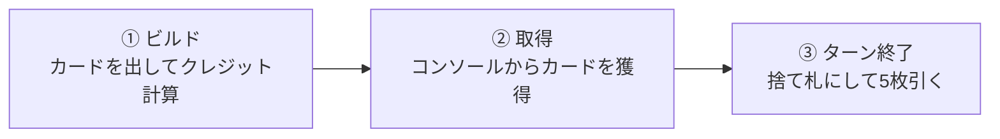

AWSサービスを組み合わせて構成を考え、カードの効果から得たクレジットでデッキを強化する。**AWS BuilderCards**は、クラウドの「ビルディングブロック」をゲームとして体験できる、2〜4人用のデッキ構築型カードゲームです。

日本語第2版は2026年9月25日から国内販売が始まり、AWSの事前知識がなくても遊べます。1ゲームの目安は20〜30分。この記事では、**社内の体験会で、ルール説明を聞いたらすぐ1ゲーム始められること**を目標に、基本パックの遊び方を紹介します。

> **対象は日本語版 第2版（2nd Edition）です。** 第1版とはクレジットや初期準備などが異なります。ミッションカードや拡張パックを使う上級ルールは、最初の対戦では省略します。

## どんなゲーム？ 目的は「得点を買う」こと

プレイヤーは最初、オンプレミス環境を表す**スターターカード10枚**から始めます。ターンごとにAWSサービスなどの**ビルダーカード**を獲得し、カード同士を組み合わせることで、より多くのクレジットを生み出せるようにします。

そのクレジットで獲得する**Well-Architectedカードが得点**になります。

| カード | 役割 |
| --- | --- |
| **スターターカード** | 最初に持つオンプレミスのカード。右上に「S」。基本的にはクレジットを生まない |
| **ビルダーカード** | Amazon EC2、Amazon S3などのサービスやツール。クレジットと組み合わせ効果を生む |
| **Well-Architectedカード** | 勝敗を決める得点カード。**3クレジットで1点**、**8クレジットで3点** |
| **ミッションカード** | 特定の構成を作る追加目標。初回は使わなくてもよい |

**Well-Architectedカードを最後の1枚まで取得した時点で終了**し、得点合計が最も高いプレイヤーの勝利。同点の場合は所有するビルダーカードの枚数で決めます。

## 最初の準備は5ステップ

テーブル中央には全員が使う**コンソール**を作り、各プレイヤーの前に自分専用の山札と捨て札置き場を用意します。

1. **スターターカードを配る。** 各自、同じ色の10枚を受け取る。使わない色は箱に戻す。
2. **ビルダーカードを2つに分ける。** 右上に取得コストのあるカードと、コスト表示のない無料カードをそれぞれシャッフルする。
3. **コンソールを作る。** 無料カードを4種類、有料カードを1種類、表向きに並べる。同じ種類が出たら重ね、異なる種類が並ぶまで補充する。得点カードは**1点を上、3点を下**にして別の山札として置く。
4. **人数に応じて得点カードを調整する。** 2人なら2人用アイコン、3人なら2・3人用、4人なら全部を使用する。
5. **各自の山札を作る。** スターター10枚をシャッフルして裏向きの「リソースパイル」に置き、そこから**5枚**を手札として引く。

順番を決めたら時計回りに進めます。

### 初期カードは「10枚」で開始

**第2版では、開始時に無料カード2枚を加えるクイックスタートが廃止されています。** 日本語の一部紹介記事には「10枚＋2枚」と書かれていますが、[日本語版開発プロジェクトの第2版リリースノート](https://github.com/jaws-ug/AWS-BuilderCards-Japanese/blob/main/v2/ReleaseNote_2ndEdition.md)と[第2版の公式英語ルール](https://pages.awscloud.com/rs/112-TZM-766/images/AWS-buildercards-rules_2024.pdf)では**10枚スタート**です。体験会ではこの手順に統一すると混乱を避けられます。

## 自分のターンにすることは3つだけ

### ① ビルド：手札からアーキテクチャを作る

ビルド開始時の手札5枚で、**ビルダーカードの枚数がオンプレミスのスターターカードより多い場合**は、スターターカードを1枚だけゲームから除外できます。これを**リタイア**と呼びます。行う場合は手札をほかのプレイヤーに見せて条件を確認し、そのターンに少なくとも1枚カードを取得します。除外したカードは捨て札にも戻しません。

その後、手札のカードを表向きに出してデプロイします。**カード1枚だけでもデプロイ可能**です。

ビルダーカードには、単独で得られるクレジットと、他のカードとの組み合わせで発動する追加効果があります。例えばAmazon EC2は単独でクレジットを生み、対応するほかのサービスと組み合わせることで追加効果を得られる場合があります。

カードに書かれている条件を満たした効果だけを計算します。**追加ドロー（黒地の「+1」）**が発動したら、このビルドフェーズ中に自分のリソースパイルからカードを引けます。引いたカードも同じターンに追加でデプロイできます。

注意するのは、**一度デプロイした構成を後から解体して組み直すことはできない**点です。また、複数カードの組み合わせ効果は原則**1対1**です。「各組み合わせにつき」といった明示がある場合を除き、1枚のカードを何度も効果の成立に使い回せません。

### ② 取得：クレジットを使ってカードを増やす

ビルドで得たクレジットを使い、コンソールから**通常は1ターンに1枚**取得します。選択肢は次のいずれかです。

- **無料のビルダーカード**：クレジット不要。公開されているカード、または無料の山札から中身を見ずに1枚取る
- **有料のビルダーカード**：表示された取得コストを支払う
- **Well-Architectedカード**：上に見えているカードを、必要なクレジットを支払って取得する

追加取得（白い雲の「+1」）が発動していれば、その分だけ取得回数が増えます。ただし**同じターンに使えるクレジットの総額は共通**で、取得するたびにコストを差し引きます。カード取得後、コンソールの空いた枠はすぐに補充します。

**獲得したビルダーカードは手札ではなく捨て札置き場へ**。次に山札をシャッフルするときから使用できるようになります。一方、**Well-Architectedカードは自分の得点置き場へ**置き、通常の山札には混ぜません。

### ③ ターン終了：捨てて5枚引く

このターンにデプロイしたカードと使わなかった手札を、すべて**ディスカードパイル（捨て札）**へ移します。その後、リソースパイルから新しく5枚引きます。

山札が足りなければ、捨て札をシャッフルして新しい山札にします。こうして以前に取得したサービスカードが次のターンから出てきます。

## 間違えやすいルール

| よくある疑問 | 基本ルール |
| --- | --- |
| 初期山札に無料カード2枚を足す？ | **足さない**。第2版の基本ルールはスターター10枚 |
| 1ターンでビルダーと得点カードを両方取れる？ | 通常の取得は**合計1回**。追加取得効果があれば増える |
| 手札を追加で引いたらすぐ使える？ | **使える**。ビルドフェーズ内で追加デプロイする |
| 3点カードが見えないが8クレジットある | 得点カードは**山の一番上から**取る。下の3点カードを選べない |
| カードを獲得したら次のターンに必ず使える？ | まず捨て札へ。再シャッフルされるまで引けないこともある |
| クレジットは次のターンに持ち越せる？ | **持ち越さない**。そのターンの取得に使う |
| 同じカードを何組ものコンボに使える？ | **原則1対1**。カードの明示的な例外を確認する |
| AWSの組み合わせが実際に動くか分からない | 初回は**カードに記載された条件**を優先する |

慣れてきたら、実際のAWSアーキテクチャとして自然な組み合わせかを話し合う遊び方もできます。ただしゲーム内の効果はAWSサービスの全機能を表しているわけではありません。

## 社内体験会なら、最初はこう進める

**1卓2〜4人、ミッションカードなし、基本ルールだけ**がおすすめです。AWS経験者と初学者が混在するなら、詳しい人がカードの効果を説明しすぎず、まずは同じルールで1周してみると参加しやすくなります。

| 進行 | 目安 |
| --- | ---: |
| ゲームの目的・カードの見方・準備 | 10分 |
| 1ゲーム（初回はやや余裕を取る） | 20〜30分 |
| 印象に残った構成の共有・振り返り | 5〜10分 |

進行役は**コンソールの補充、取得は通常1回、カードを獲得してもすぐ手札には来ない**という3点を最初に確認するとスムーズです。

カードのQRコードから実際のサービスを調べられます。終了後には、得点を伸ばした組み合わせについて「なぜこのサービスを組み合わせるのか」を話すと、交流と学習の両方につながります。

## まとめ

AWS BuilderCardsのルールは、**「カードを出してクレジットを作る → カードを獲得して山札を育てる → 得点カードを集める」**と考えると覚えやすくなります。

AWSに詳しくなくても始められますし、詳しい人ほどカードの組み合わせからアーキテクチャの話を広げられます。社内で一度遊んでみる入口として、まずは基本パック・ミッションなしの1ゲームから始めてみてください。

※ルールはオンラインで更新される場合があります。実施前に[公式ゲームページ](https://aws.amazon.com/gametech/buildercards/)と[日本語版プロジェクトのルールブック](https://github.com/jaws-ug/AWS-BuilderCards-Japanese/blob/main/v2/Ja_rules_2024.pdf)を確認してください。

## 参考資料

- [JAWS-UG — AWS BuilderCards日本語版 第2版ルールブック](https://github.com/jaws-ug/AWS-BuilderCards-Japanese/blob/main/v2/Ja_rules_2024.pdf)
- [JAWS-UG — 第2版リリースノート・変更点](https://github.com/jaws-ug/AWS-BuilderCards-Japanese/blob/main/v2/ReleaseNote_2ndEdition.md)
- [AWS — BuilderCards公式ゲームページ](https://aws.amazon.com/gametech/buildercards/)
- [AWS — BuilderCards 第2版 英語ルールPDF](https://pages.awscloud.com/rs/112-TZM-766/images/AWS-buildercards-rules_2024.pdf)
- [AWS builders.flash — AWS BuilderCards 2nd Editionの遊び方](https://aws.amazon.com/jp/builders-flash/202509/builder-cards-2nd-edition/)
