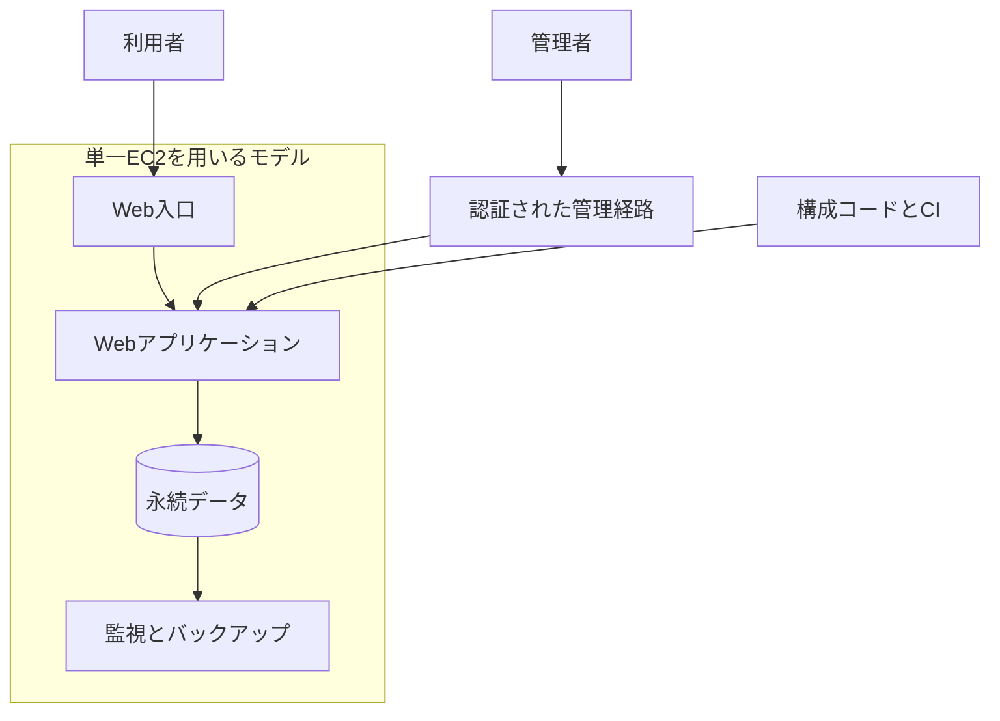
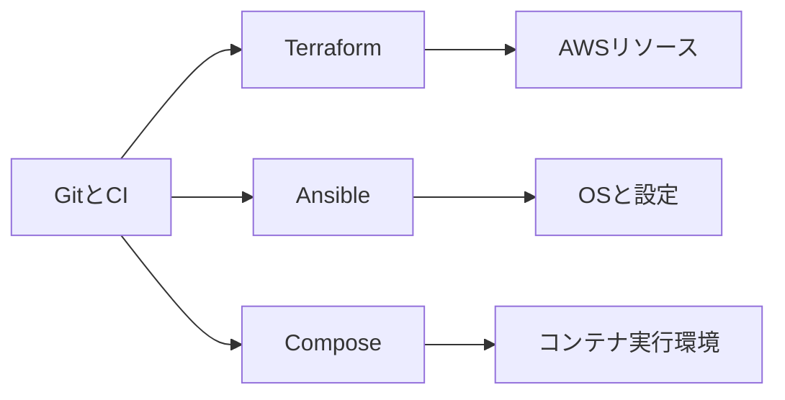
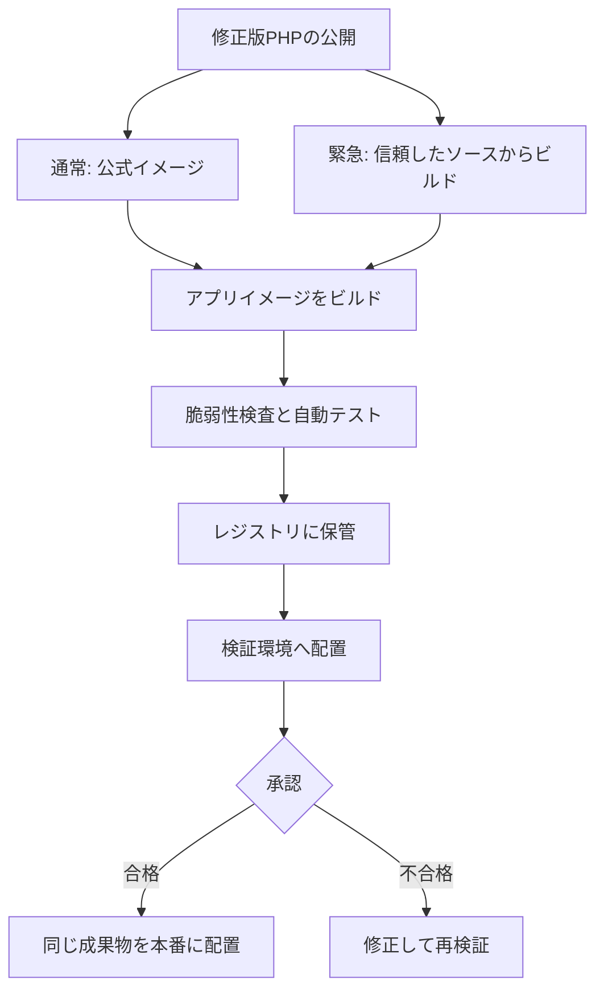
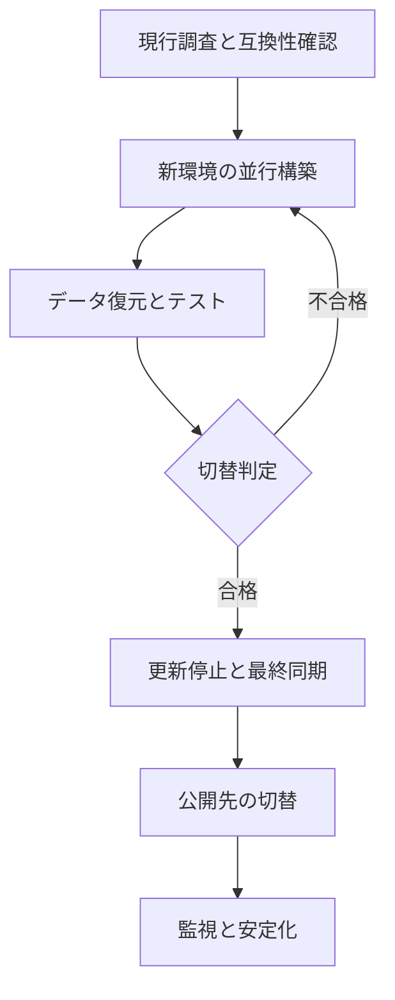

## はじめに

長期間運用しているWebシステムのサーバーを刷新する際、OSやPHP、データベースを新しくするだけでは、数年後に同じ更新作業が発生します。今回考えたいのは、移行を契機に**次回以降の更新・障害復旧を再現できる仕組みを作ること**です。

本記事では、一般化した小規模Webシステムを例に、単一EC2構成を維持しながら、安全性・保守性・更新速度を改善する設計案を考えます。実際の組織やシステムの構成・設定・契約を公開するものではなく、構築済みの実績や性能測定結果でもありません。

参考にした記事は次の2つです。

- [AWSインフラ設計のベストプラクティスを目指して](https://zenn.dev/so_engineer/articles/ff5d595a488df0)
- [pixiv inside：PHPの緊急リリースへの対応事例](https://inside.pixiv.blog/2026/10/22/193321)

前者からはインフラの権限・環境分離、構成管理、成果物管理といった設計原則を、後者からはPHP更新を迅速に適用するためのビルド・デプロイの考え方を取り入れます。後者の記事の詳細な時系列・測定値はここでは引用せず、公開されているDocker・PHPの技術資料に基づく設計案として説明します。

## 1. 単一EC2を維持するという選択

AWSにはECS、RDS、ALBなど多くのマネージドサービスがあります。ただし、小規模システムでは全てを採用することが適切とは限りません。稼働規模、停止許容時間、保守体制、予算を踏まえて判断する必要があります。

ここでは単一EC2を例に、公開経路と管理経路を分け、アプリケーションの実行環境をDockerで管理し、永続データをコンテナとは独立させる設計を考えます。



図は論理的なモデルです。インターネット公開の有無、ネットワーク境界、DBの配置、管理経路は個別に検討します。単一ホストは障害点を共有するため、高可用性構成と同等ではありません。バックアップからの復元時間が要求を満たさない場合は、RDSや複数インスタンスへの分離を検討します。

## 2. インフラ・実行環境・検証を分ける

環境の再現性を高めるため、責務ごとにツールを分けます。

| 技術 | 責務 |
| --- | --- |
| Terraform | AWSリソースの定義・変更差分の管理 |
| Ansible | OS、ミドルウェア、設定ファイルの構成管理 |
| Docker Compose | コンテナの起動・ネットワーク・永続化設定 |
| Buildx / BuildKit | コンテナイメージのビルド |
| コンテナレジストリ | 検証済み成果物の保管 |
| CI/CD | ビルド、検証、承認、配置 |

重要なのはツールの数ではなく、何を正本にするかです。例えばAWSリソースの定義はTerraform、OSの設定はAnsible、コンテナの実行設定はComposeを正本にします。同じ設定を複数の場所から独立して変更しないようにします。

既存のAWSリソースを移行する場合、最初から全てをTerraformの管理下に置く必要はありません。新規リソースから管理を始め、既存ネットワークは参照に留める方法もあります。stateの保護、変更差分のレビュー、削除防止は必須の考慮事項です。



日常運用は必ずしもCLIで行う必要はありません。構成変更はコードとレビューを通し、CIの画面から実行・承認・結果確認を行います。GUIで直接変更した場合はコードへの反映と差分確認が必要です。

## 3. PHPの緊急更新に備える

DockerでPHPを動かす場合、ホストOSのパッケージを更新しても、コンテナ内のPHP本体は更新されません。修正版ベースイメージの取得、アプリケーションの再ビルド、テスト、コンテナの再配置が必要です。

公式イメージを使用する通常運用には、PHP本体のリリースと修正版イメージの公開に時間差が発生し得るという課題があります。対策として、平常時と緊急時の取得経路を分け、以降の検証とデプロイを共通化します。



緊急経路は、[docker-library/php](https://github.com/docker-library/php) のビルド定義を参考に、修正版PHPソースの出所・署名またはチェックサムを検証したうえでビルドする考え方です。修正版ソース自体が未公開なら、この方法でもパッチは入手できません。また、独自ビルドには拡張モジュールや設定・ABIの互換性という追加リスクがあります。公式イメージが公開された後も、通常経路へ戻す際に同じ検証を通します。

アプリ用Dockerfileのベースイメージをビルド引数として扱えば、通常と緊急で後段の設定を共通化できます。

```dockerfile
ARG PHP_BASE_IMAGE
FROM ${PHP_BASE_IMAGE}
# アプリ固有の拡張・依存・設定を再現可能な形で導入
```

これは構成の例で、そのまま稼働できる完成したDockerfileではありません。実際は利用するPHP系統・SAPI、OSライブラリ、拡張、アーキテクチャを確認します。

BuildKitのキャッシュはビルド時間短縮に有効ですが、脆弱性修正対象を古いキャッシュから再利用しないようにします。複数イメージの依存関係が複雑になった段階でDocker Bakeを導入する方法もあります。

## 4. 緊急時に安全に止められる設計

PHP自体に重大な問題があるとき、PHPで実装したメンテナンス画面では、脆弱な実行環境へのアクセスを十分に遮断できない可能性があります。

そこで、リバースプロキシ等の入口で対象サービスへの転送を止め、PHPを呼び出さずに静的なメンテナンス応答を返せる仕組みを検討します。直接アクセスできる別の入口やAPI、バックグラウンドジョブも影響判定の対象です。単なる画面の切替ではなく、実際の到達性を検証します。

公開前に決めておきたいのは、誰が停止・解除を承認するか、どのサービスに影響があるか、どの条件で再開するかです。

## 5. 更新の安全性を成果物で担保する

同一のタグでもイメージの内容が変わり得るため、コミット、ビルドID、ベースイメージのダイジェスト、完成したイメージのダイジェストを追跡します。検証環境と本番環境で別々に再ビルドせず、**検証済みの同一成果物を昇格**させる方式を採用します。

自動テストでは、PHP版・拡張・依存ライブラリ、HTTPの疎通、主要な業務操作、DB接続などを確認します。脆弱性検査やSBOMも有効ですが、検査結果だけで安全と断定せず、対象CVEやベンダーの修正情報と照合します。

旧イメージを保持すればアプリの切り戻しは容易になります。ただしDBスキーマや業務データが更新されている場合、旧イメージだけを戻しても復旧できないことがあります。アプリとデータの復旧手順は分けて設計します。

## 6. 管理接続と権限の設計

SSHのインバウンド公開を抑える方法として、AWS Systems Manager Session ManagerやEC2 Instance Connect Endpointを検討できます。Session Managerには通常のシェル接続だけでなくSSH通信やポートフォワーディングを通す方式もあります。

一方で、Agent、OS対応、IAM、AWS API、ネットワークへの依存が増えます。SSH経由の操作内容をSession Managerが記録できない点にも注意が必要です。管理経路を変更する前に、既存のSSH・SFTP・DBクライアントや自動化ツールの動作を検証し、緊急時の代替経路を確保します。

DB権限やコンテナの権限はアプリごとに制限し、秘密情報をGitに直接登録しないことも重要です。単一EC2内の分離は、独立したホストやアカウントの分離と同等ではありません。

## 7. 移行は段階的に実施する



新しい実行環境への移行と、運用基盤の全面自動化を同時に完了させる必要はありません。まずサポート中の環境への移行、互換性確認、バックアップ・復元、管理接続、安全な更新手順を確保します。その後、レジストリ・CI/CD・緊急ビルド・キャッシュ等を段階的に改善します。

切替では旧環境への書き込みを停止し、DBと関連ファイルの整合性を確保します。切替後に更新されたデータの扱いを決めておかなければ、公開先を元に戻すだけでは安全な切り戻しになりません。

## 8. 評価する指標

構成を新しくしたこと自体ではなく、運用上の成果を測定します。

- 脆弱性情報の検知から影響判定、暫定緩和、本番修正までの時間
- ビルド・テスト・デプロイの所要時間と変更失敗率
- バックアップの復元成功率と復旧所要時間
- インフラ構成変更の再現性、手作業の削減量
- インフラ利用料だけでなく、構築・保守・障害対応の工数

## おわりに

小規模な環境でも、インフラの構成コード、再現可能なコンテナビルド、検証済み成果物の配置、復元できるバックアップを組み合わせれば、将来の更新を安全に行うための基盤を整えられます。

大規模な技術事例から学ぶべきことは、採用サービスの数ではなく、**障害や緊急更新を想定した設計と、その手順を平常時から再現可能にすること**だと考えています。

## 参考資料

- [AWSインフラ設計のベストプラクティスを目指して](https://zenn.dev/so_engineer/articles/ff5d595a488df0)
- [pixiv inside：PHPの緊急リリースへの対応事例](https://inside.pixiv.blog/2026/10/22/193321)
- [Docker Build ベストプラクティス](https://docs.docker.com/build/building/best-practices/)
- [Docker Bake](https://docs.docker.com/build/bake/)
- [Docker公式PHPイメージの定義](https://github.com/docker-library/php)
- [PHP Supported Versions](https://www.php.net/supported-versions.php)
- [AWS Session Manager](https://docs.aws.amazon.com/systems-manager/latest/userguide/session-manager.html)
- [AWS Architecture Icons](https://aws.amazon.com/architecture/icons/)
