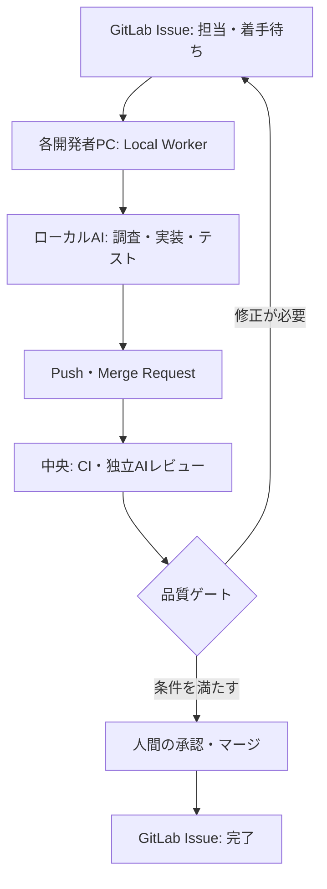

GitLabは[Merge Request Pipelines](https://docs.gitlab.com/ci/pipelines/merge_request_pipelines/)で、変更に対してCIを実行する仕組みを提供しています。また、[承認ルール](https://docs.gitlab.com/user/project/merge_requests/approvals/rules/)を使えば、マージ前に必要なレビューを設定できます。

一方、AIエージェントにコードの調査・修正を任せると、実装作業そのものも自動化の対象になります。

そこで必要になるのが、**AIが作業する場所と、成果物を検証・承認する場所を分ける設計**です。

この記事では、GitLabをタスクと変更履歴の中心に据え、各開発者のPCでAIを実行し、中央側でCI・レビュー・完了判定を行う構成案を紹介します。新しいツールの発明ではなく、**既存の開発基盤にAIエージェントをどう組み込むか**がテーマです。

## 全体構成

構成は大きく3層です。

| 層 | 担当すること |
| --- | --- |
| **GitLab** | Issue、MR、変更履歴、CI結果、承認記録の管理 |
| **Local Worker** | 自分に割り当てられたIssueを検知し、手元のAI実装を起動 |
| **中央の制御・検証** | CIの結果確認、AIレビュー、状態遷移、承認待ち、完了判定 |

**実装は各自のPC、検証と進捗管理は中央**という役割分担です。中央サーバーがすべてのAI実装を実行する必要はありません。

## なぜローカルで実装するのか

開発者のPCには、エディタ、作業ブランチ、ローカルテスト環境があります。AIが同じ環境を使えば、開発者は実行内容を確認し、必要な操作をその場で承認できます。

例えば、Issueに担当者を設定して「着手待ち」にすると、PC上の小さな常駐プログラム（Local Worker）がタスクを取得します。

Workerはタスクを「実行中」に変更し、ローカルのエージェントを起動します。エージェントは調査・修正・テストを行い、成果物をPushします。

ただし、**ローカル実行にはPCの電源やネットワークへの依存**があります。オフライン時は処理が止まります。そのため、中央側には停滞検知や再開可能なタスク管理が必要です。

## 中央で検証する理由

実装したAIが「完成」と報告しても、それだけでマージを許可する構成にはしません。

中央側ではMRを起点に、ユニットテスト、静的解析、必要な結合テストなどを実行します。さらに、実装とは別のコンテキストでAIレビューを行い、仕様との不一致や変更の影響を確認します。

GitLabのCIは検証結果を残す仕組みです。承認ルールは、誰がマージを認めるかを制御する仕組みです。**AIレビューは判断材料の一つであり、CIや人間の承認の代わりではありません。**

なお、GitLabの必須承認ルールなどはプランやバージョンによって利用条件が異なります。構成を導入する際は、利用環境の機能を確認する必要があります。

## 自動化で重要になる状態管理

AIの実装が複数同時に走る場合、同じIssueを二重に処理しない仕組みが必要です。

例えば、次の状態を管理します。

`着手待ち → 実行中 → 検証中 → レビュー待ち → 完了`

失敗した場合は、原因を記録して修正待ちに戻します。判断が必要な場合は、人間の回答があるまで停止します。

ただし、**Issueのラベルを変更するだけでは二重着手を防げません**。複数Workerが同時にタスクを取得する可能性があるため、排他的な取得処理や有効期限付きの実行権（lease）などが必要です。

中央は、タスクの状態と結果を管理します。ローカルAIが内部で何度試行錯誤したかを、すべて中央の工程に展開する必要はありません。

## 共通の開発ルールはどう配るか

複数人・複数プロジェクトでAIを使うと、エージェントごとに実装手順やチェック基準がばらつく可能性があります。

そこで、共通のSkills、実行時の制約、評価方法をリポジトリで管理し、各プロジェクトにバージョンを固定して配布する方法が考えられます。

配布用CLIを用意すれば、特定のAI製品に依存しない共通ルールと、製品ごとの設定を分けられます。

ただし、**Skillsに書いた指示だけではルールを強制できません**。テスト、権限、承認などの重要な制約はCIやアクセス制御で担保します。

## まとめ

この構成案の要点は、**AIの実装作業を分散し、検証と意思決定を中央に集約すること**です。

- GitLabをタスクと変更履歴の正本にする
- 各開発者PCのAIが実装する
- 中央でCI・レビュー・承認・完了を管理する

実装の自律性を確保しつつ、成果物の受入条件を統一できます。

一方で、Workerの停止、二重着手、権限管理、中央側の障害など、新たな運用課題も生まれます。最初から完全自律・無条件自動マージを目指すのではなく、**タスク取得からMR検証までを小さく接続し、段階的に自動化する**構成が現実的です。

## 参考資料

- [GitLab Docs — Merge request pipelines](https://docs.gitlab.com/ci/pipelines/merge_request_pipelines/)
- [GitLab Docs — Merge request approval rules](https://docs.gitlab.com/user/project/merge_requests/approvals/rules/)
- [GitLab Docs — Merge request approval settings](https://docs.gitlab.com/user/project/merge_requests/approvals/settings/)
