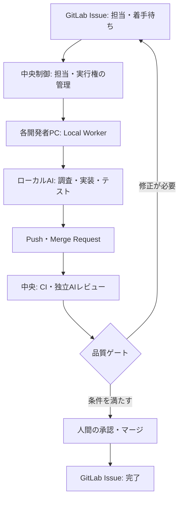

GitLabは[Merge Request Pipelines](https://docs.gitlab.com/ci/pipelines/merge_request_pipelines/)でMRの変更を自動検証できます。一方、[MR承認ルール](https://docs.gitlab.com/user/project/merge_requests/approvals/rules/)はPremium・Ultimateの機能です。**検証の自動化と、承認の強制は別の仕組み**です。

一方、AIエージェントにコードの調査・修正を任せると、実装作業そのものも自動化の対象になります。

そこで考えられるのが、**AIの実装環境と、成果物を受け入れる判断基準を分離する設計**です。

この記事では、GitLab Issueをタスクの正本に据え、各開発者のPCでAIを実行し、中央側でCI・レビュー・完了判定を行う構成案を紹介します。新しいツールの発明ではなく、**「ローカルで作業し、中央で受け入れる」責任の境界**がテーマです。

## 全体構成

構成は大きく3層です。

| 層 | 担当すること |
| --- | --- |
| **GitLab** | Issueにタスクを記録し、Git・MR・CIに成果物と判断の証拠を残す |
| **Local Worker** | 自分に割り当てられたIssueを検知し、手元のAI実装を起動 |
| **中央の制御・検証** | CIの結果確認、AIレビュー、状態遷移、承認待ち、完了判定 |

**実装は各自のPC、検証と進捗管理は中央**という役割分担です。中央サーバーがすべてのAI実装を実行する必要はありません。

## なぜローカルで実装するのか

開発者のPCには、エディタ、作業ブランチ、ローカルテスト環境があります。AIが同じ環境を使えば、開発者は実行内容を確認し、必要な操作をその場で承認できます。

例えば、Issueに担当者を設定して「着手待ち」にすると、PC上の小さな常駐プログラム（Local Worker）がタスクを取得します。

Workerは中央制御へ着手を要求します。中央制御が実行権を割り当て、Issueを「実行中」に更新してから、Workerがローカルのエージェントを起動します。エージェントは調査・修正・テストを行い、成果物をPushします。**実行権がないWorkerは着手できません。**

ローカル実行は開発者が操作を確認しやすい反面、**PCの電源やネットワークに依存**します。例えば実装中にPCが停止した場合、中央制御は一定時間更新がないタスクを検知し、再割当てを判断します。古い実行の成果物が混入しないよう、実行IDも照合します。

## 中央で検証する理由

実装したAIが「完成」と報告しても、それだけでマージを許可する構成にはしません。

中央側ではMRを起点に、ユニットテスト、静的解析、必要な結合テストなどを実行します。必要に応じて、実装とは別のコンテキストでAIレビューを行い、仕様との不一致や変更の影響を探します。ただし、**別のAIを使っても誤解や見落としが独立するとは限りません**。

GitLabのCIは検証結果を残す仕組みです。承認ルールは、誰がマージを認めるかを制御する仕組みです。**AIレビューは判断材料の一つであり、CIや人間の承認の代わりではありません。**

承認ルールの設定はGitLab Premium・Ultimateが対象です。Freeや旧バージョンでは同等の強制機能を前提にせず、保護ブランチ・権限・中央制御による判定を組み合わせる必要があります。

## 中央で実装する方式との違い

| 方式 | 向いている条件 | 注意点 |
| --- | --- | --- |
| **各PCで実装** | 開発者のエディタ・ローカル環境や対話的承認を使う | PC停止、環境差分、実行権管理 |
| **中央で実装** | 一律の実行環境、常時稼働、集中したジョブ管理を重視 | 隔離環境の用意、秘密情報・権限の集中 |

どちらでも、**受入条件は実装担当から独立して評価**できます。ローカル方式が常に優れているわけではありません。

複数Workerへの配分では、**担当PCの数だけ並列化すればよいわけではありません**。Anthropicが[Building effective agents](https://www.anthropic.com/research/building-effective-agents)で紹介するParallelizationは、独立した作業単位を並列に実行する構成です。実際の開発では、ファイルの競合、共通ライブラリの変更、先行MRへの依存を確認してから並列化します。

## 自動化で重要になる状態管理

AIの実装が複数同時に走る場合、同じIssueを二重に処理しない仕組みが必要です。

例えば、次の状態を管理します。

`着手待ち → 実行中 → 検証中 → 承認待ち → 完了`

修正できる失敗は理由を付けて差し戻し、仕様や権限の判断が必要なら確認待ちにします。どちらも、次に再開してよい条件をIssueに残します。

ただし、**Issueのラベルを変更するだけでは二重着手を防げません**。複数Workerが同時にタスクを取得する可能性があるため、排他的な取得処理や有効期限付きの実行権（lease）などが必要です。

中央は、タスクの状態と結果を管理します。ローカルAIが内部で何度試行錯誤したかを、すべて中央の工程に展開する必要はありません。

## 共通の開発ルールはどう配るか

複数人・複数プロジェクトでAIを使うと、エージェントごとに実装手順やチェック基準がばらつく可能性があります。

そこで、共通のSkills、実行時の制約、評価方法をリポジトリで管理し、各プロジェクトへバージョンを固定して配布する方法が考えられます。

配布用CLIを用意すれば、特定のAI製品に依存しない共通ルールと、製品ごとの設定を分けられます。

ただし、**Skillsに書いた指示だけではルールを強制できません**。テスト、権限、承認などの重要な制約はCIやアクセス制御で担保します。IssueやMRの文章もAIへの無条件の命令とは扱わず、権限変更などは別の承認経路で判断します。

## まとめ

この構成案の要点は、**AIの実装作業を分散し、検証と意思決定を中央に集約すること**です。

- GitLabをタスクと変更履歴の正本にする
- 各開発者PCのAIが実装する
- 中央でCI・レビュー・承認・完了を管理する

実装の自律性を確保しつつ、成果物の受入条件を統一できます。

一方で、Workerの停止、二重着手、権限管理、中央側の障害など、新たな運用課題も生まれます。導入時は、**Issue取得→1件のローカル実装→MR検証→人間の承認**までを先に接続し、滞留時間・差し戻し理由・重複実行の有無を計測すると、拡張判断の材料になります。これは導入手順の提案であり、効果検証済みの構成ではありません。

## 参考資料

- [Anthropic — Building effective agents](https://www.anthropic.com/research/building-effective-agents)
- [GitLab Docs — Merge request pipelines](https://docs.gitlab.com/ci/pipelines/merge_request_pipelines/)
- [GitLab Docs — Merge request approval rules](https://docs.gitlab.com/user/project/merge_requests/approvals/rules/)
- [GitLab Docs — Merge request approval settings](https://docs.gitlab.com/user/project/merge_requests/approvals/settings/)
