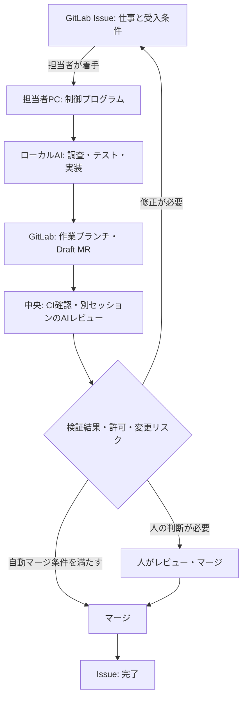

GitLabの[Merge Request Pipeline](https://docs.gitlab.com/ci/pipelines/merge_request_pipelines/)は変更を自動検証できます。しかし、AIによる実装まで導入するなら、**タスクの開始、実装中の権限、レビュー、完了の判断をどこで管理するか**も決める必要があります。

ここでは、**実装は開発者のPC、検証とマージ判定は共有側**に置く構成を紹介します。既存のGitLabとAIエージェントを組み合わせた、**匿名化したローカル検証例**です。導入済みの本番システムや、効果測定済みの標準アーキテクチャとしては扱いません。

## GitLabを介して2つの役割をつなぐ

| 役割 | 行うこと |
| --- | --- |
| **Issue・MR・CI** | 受入条件、状態、変更、検証結果、承認・マージの履歴を記録 |
| **担当者PC** | 人の着手操作を受け、AIの実装・テスト・pushを進める |
| **中央側** | CI・AIレビュー・差し戻し・マージ判定・完了検知を行う |

中央は実装を代行しません。担当者のPCからGitLabへアクセスし、中央もGitLabを参照します。**中央から開発者PCへ直接接続する経路を作らない**構成です。

## 手元で実装するのは、環境と承認を近づけるため

担当者がIssueを選んで着手すると、ローカルの制御プログラムが担当者と状態を確認します。受入条件がまだなければ、AIが既存コードを**読み取り中心で調査**し、人と対話して受入条件を確定します。その後、同じエージェントが作業ブランチとworktreeで実装します。

この方式では、AIが許可外のツールを要求した場合、**担当者の画面で承認・拒否**できます。指示文だけで権限を管理せず、ツールの許可設定でも制限します。

### worktreeを使えるローカルPHP環境を作る

PHP案件では、リポジトリや作業ブランチごとに、**異なるPHPバージョン・Webサーバー設定・Git管理対象外の必須ファイル**が必要になることがあります。

ローカル検証例では、バージョン管理ツールでPHPやテスト実行環境を揃え、別の**ローカル環境補助ツール**が、リポジトリごとの設定からApacheの検証環境を起動する仕組みを用意しています。新しいworktreeには必要なローカルファイルを準備し、環境の切り替えを簡単にします。

これはAI向けのプロンプトではなく、**人もAIも同じ操作で検証できる環境を供給するHarness**です。社内独自のツール名・設定ファイル名・内部構成は掲載していません。Git管理対象外のファイルには秘密情報が含まれ得るため、コピー先の権限やログへの露出は別途管理が必要です。

## 中央は「実装の報告」ではなく結果を見る

実装側がpushした後、中央では構文チェック、静的解析、依存関係の検査、単体テスト、**使い捨てDBによるテスト**などを実行します。実例では、既存の静的解析警告はベースライン化し、新しい指摘を検出する方式も採っています。

CIが成功したら、**実装側の会話を引き継がないレビューエージェント**が、受入条件、差分、CI結果から問題を探します。独立したセッションでも誤りが完全に独立するとは限らないため、レビューはCIの代替にはしません。

検証に失敗すれば、**失敗ログと対象コミットをIssueへ戻す**。受入条件が曖昧なら人の判断を待ちます。状態変更の大部分はAIでなくプログラムが担当します。

マージは、依頼者が事前に許可し、かつ保護対象の変更・重要な指摘・受入条件の未達などの条件に該当しない場合に限って**自動実行の候補**になります。それ以外は人がレビューします。いずれも**検証済みコミットSHAの一致**を確認してから進めます。

## 二重着手を防ぐ方法は一つではない

ラベルを「実行中」に変えるだけでは、二台のPCが同時にIssueを取りに行く競合を防げません。

このローカル実装では、**GitLab上の着手記録の順序で有効な実行を選び、後発の実行は開始しない**方式を採っています。中央APIからleaseを配る方式ではありません。実装を中央の可用性に依存させない利点がありますが、競合と障害時の振る舞いは実機で確認する必要があります。

同じ作業を無限にやり直さないため、再試行回数、同一失敗の連続回数、CI待ち時間などにも停止条件を設けます。

## 現時点の検証範囲

**ローカルでは、一件の小さな変更について、受入条件の確定→実装→CI→別セッションのAIレビュー→条件付き自動マージまで確認**できています。

一方、常時稼働する中央サーバーへの本番移行は未完了です。別PCからの再開、長時間放置、失敗からの差し戻しなど、仕様テストに留まるケースもあります。また、**素のAIエージェントと比較した生産性・品質の改善効果は未測定**です。

## まとめ

この構成の価値は、**実装者の手元の環境と承認を活かしながら、検証とマージ判定を共有の仕組みに揃えること**です。

GitLabを正本にし、AIが試行錯誤する部分と、テスト・権限・状態遷移を分離します。実装を中央に集約する方式も選択肢であり、ローカル方式の採用にはPC停止・環境差分・競合への対策が必要です。

## 参考資料

- [GitLab Docs — Merge request pipelines](https://docs.gitlab.com/ci/pipelines/merge_request_pipelines/)
- [GitLab Docs — Merge request approval rules](https://docs.gitlab.com/user/project/merge_requests/approvals/rules/)
- [Anthropic — Building effective agents](https://www.anthropic.com/research/building-effective-agents)
- [OpenAI — Harness engineering](https://openai.com/index/harness-engineering/)
