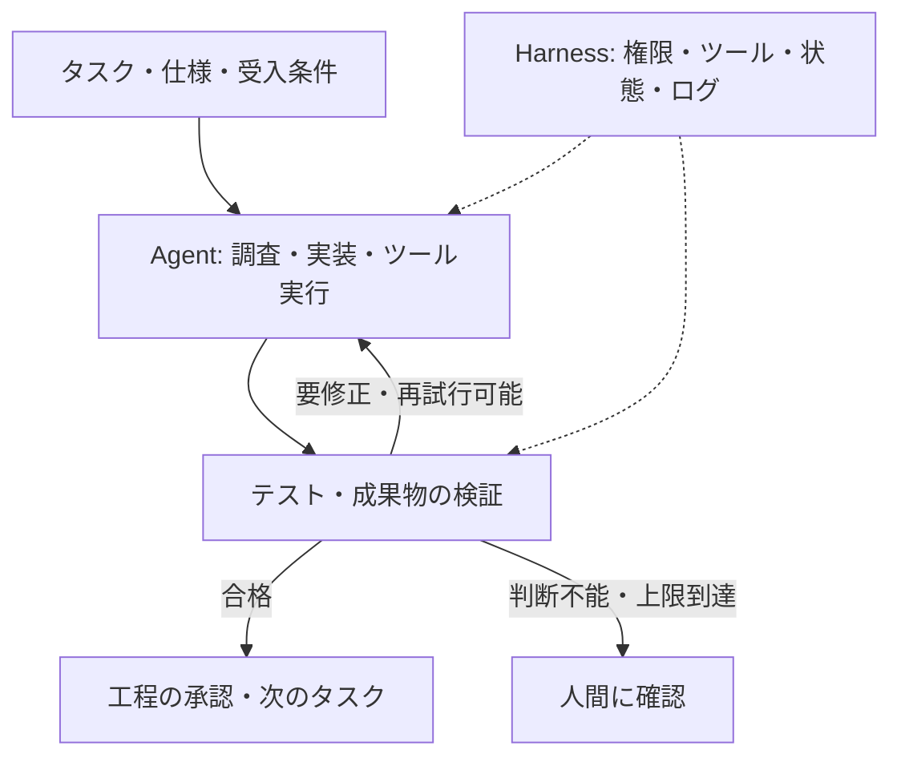

OpenAIは[Prompt engineering](https://developers.openai.com/api/docs/guides/prompt-engineering)を、モデルが要件に沿った出力を返せるよう指示を設計する技術と説明しています。プロンプトは今も重要です。

一方、OpenAIの[Harness engineering（2026年2月）](https://openai.com/index/harness-engineering/)では、人間の仕事が「コードを直接書くこと」から、**AIが仕事を進められる環境、制約、フィードバックの設計**へ広がる事例が紹介されています。

この記事では、プロンプト、コンテキスト、Agent Loop、Graph、Harness、評価（Evals）の関係を整理します。これらは古い手法が順番に廃れたという歴史ではなく、**AIに任せる作業が増えた結果、設計対象が広がった**と捉えると理解しやすくなります。

## プロンプトだけでは何が足りないのか

例えば「ログイン処理の不具合を直して」と指示するだけでは、AIは次の点を判断できないことがあります。

- どのコードと仕様を参照するか
- どの操作やファイル変更まで許可されているか
- テストが失敗したときにどう修正し、いつ停止するか
- 何を証拠に完了と判断するか

長い指示を追加すれば解決する問題もあります。しかし、**実際にファイルを読み、テストし、結果を記録する仕組み**はプロンプトの文章だけでは実現しません。

Anthropicの[Building effective agents](https://www.anthropic.com/research/building-effective-agents)は、まず単純な構成を使い、必要になった段階でツール、Workflow、Agentへ複雑さを増やすことを推奨しています。

## AI開発を支える6つの要素

| 要素 | 設計するもの | 主な役割 |
| --- | --- | --- |
| **Prompt** | 指示・制約・出力形式 | 何をしてほしいか伝える |
| **Context** | 仕様・コード・過去の作業情報 | 判断に必要な材料を渡す |
| **Agent Loop** | ツール操作と結果確認の反復 | 調査・実装・修正を進める |
| **Graph / Workflow** | 工程・分岐・依存関係 | 実行順、差し戻し、承認を管理する |
| **Agent Harness** | ツール、権限、状態保存、実行環境 | AIが行動できる条件を整える |
| **Evaluation Harness** | 課題、試行、採点、記録 | 実行結果を比較・改善する |

この分類は技術の正式な世代区分ではなく、**設計の責務を分けるための整理**です。Agent HarnessとEvaluation Harnessも同じものではありません。

Anthropicの[Demystifying evals for AI agents](https://www.anthropic.com/engineering/demystifying-evals-for-ai-agents)は、前者をモデルにツールを使わせる実行基盤、後者をタスク実行・記録・採点する評価基盤として区別しています。

## ループ・グラフ・ハーネスはどう組み合わさるか

**ループ**は、ひとつの仕事を達成するための試行錯誤です。**グラフ**は、複数工程の依存関係や分岐を表します。**ハーネス**は、その両方が動くための実行環境と制約を支えます。

グラフを使わないAgentも、単純なループで十分な仕事もあります。ハーネスは「グラフの次に登場する製品」ではなく、単一Agentの段階から必要な構成要素です。

Anthropicは[長時間実行するAgentの研究](https://www.anthropic.com/engineering/effective-harnesses-for-long-running-agents)で、コンテキストの切り替わりを越えて仕事を続けるため、機能リスト、Git履歴、進捗記録、作業環境の再起動手順を使っています。ここでは、単にプロンプトを長くするより、**次の実行が信頼できる状態から再開できること**が重要になります。

## 「動いた」から「改善できる」へ

例えばAIが不具合修正のPRを作ったとします。

最初はユニットテストに通っても、結合テストで失敗するかもしれません。ここで必要なのは「もう一度頑張って」という指示ではなく、**失敗したテストと期待値を次の試行に渡すこと**です。

さらに、同じ失敗が別のタスクでも起きるなら、受入条件や実行環境、ツールの使い方に改善余地がある可能性があります。ハーネスへの変更は、再現可能な評価で検証してから適用します。

Anthropicの評価ガイドは、**Task（課題）、Trial（試行）、Grader（採点）、Transcript（実行記録）、Outcome（最終結果）**を区別します。例えば「テスト成功」だけでなく、変更対象外のファイルを触っていないか、何回の試行が必要だったかも評価できます。

OpenAIの[改善ループの実装例](https://developers.openai.com/cookbook/examples/agents_sdk/agent_improvement_loop)も、実行記録と人間・モデルによるフィードバックから評価ケースを作り、ハーネスの改善案につなげています。

ただし、**自己改善とは自動的に正しく進化することではありません**。評価基準が不適切なら、スコアを上げても品質は改善しません。変更の有効性は、独立した評価と必要に応じた人間の確認で判断します。

## 何が壊れたら、どこを直すか

@m4lkxxの[「Harness, Loops, Graphs」](https://x.com/m4lkxx/status/2114338456750997922)は、Harnessを「何ができるか」、Loopを「正しいか」、Graphを「次に何をするか」という問いで整理しています。

この見方を使うと、問題が起きたときに**長いプロンプトを書き直す前に、どの仕組みが不足しているか**を考えられます。

| 起きている問題 | 改善する候補 |
| --- | --- |
| 要件の解釈が毎回ずれる | **Prompt / Context**：仕様と受入条件を明確にする |
| 必要なテストを実行できない・途中で作業を忘れる | **Harness**：ツール、権限、永続的な進捗記録を整える |
| AIが「完了」と報告するが、動作を確認できない | **Loop / Check**：実行可能なテストと成果物の検証を入れる |
| 同じ失敗を繰り返してコストを消費する | **Loop / Feedback**：期待値と実測値、試行履歴、停止条件を渡す |
| 独立した作業が直列化する・承認が抜ける | **Graph / Workflow**：依存関係、分岐、承認ゲートを設計する |
| 変更のたびに以前の不具合が再発する | **Evals**：回帰ケースを蓄積し、変更前後を比較する |

例えばバグ修正なら、着手前に**何が失敗すれば不具合を再現でき、何が通れば修正済みと判断するか**を決めます。再現テストが作れる場合は、修正前に失敗し、修正後に成功することを確かめます。テストを作れない場合も、判断に使う別の証拠を先に明示します。

この表は診断の手がかりであり、必須の成熟度階段ではありません。複数の仕組みが同時に不足する場合もあります。Anthropicの[Building effective agents](https://www.anthropic.com/research/building-effective-agents)も、課題を満たす最も単純な構成から始める方針を示しています。

**能力を増やすことと、実行を許可することも別です。** 取り消しにくい操作や権限変更には、モデルの自己評価に依存しない権限制御と承認が必要です。複雑な構成ほど、運用コストやデバッグの負担も増えます。

また、OpenAIのHarness engineeringは特定チームの開発事例です。その効果や運用方針を、すべての組織に当てはまる実証結果として扱うことはできません。

## まとめ

**プロンプトエンジニアリングは終わっていません。** 指示の品質は今も重要です。

変わったのは、設計する対象の広さです。Promptで意図を伝え、Contextで材料を渡し、Agentに操作を任せ、Workflowで進行を管理し、HarnessとEvalsで継続実行と改善を支えます。

**「どう指示するか」だけでなく、「どんな環境なら安全に実行し、正しさを確認できるか」まで設計する。** これがAIコーディング開発を捉える実用的な視点です。

## 参考資料

- [OpenAI — Prompt engineering](https://developers.openai.com/api/docs/guides/prompt-engineering)
- [Anthropic — Building effective agents](https://www.anthropic.com/research/building-effective-agents)
- [Anthropic — Effective harnesses for long-running agents](https://www.anthropic.com/engineering/effective-harnesses-for-long-running-agents)
- [OpenAI — Harness engineering: leveraging Codex in an agent-first world](https://openai.com/index/harness-engineering/)
- [Anthropic — Demystifying evals for AI agents](https://www.anthropic.com/engineering/demystifying-evals-for-ai-agents)
- [OpenAI Cookbook — Build an Agent Improvement Loop](https://developers.openai.com/cookbook/examples/agents_sdk/agent_improvement_loop)
- [m4lkxx — Harness, Loops, Graphs: What Each Layer Fixes and What It Breaks（着想となった投稿）](https://x.com/m4lkxx/status/2114338456750997922)
