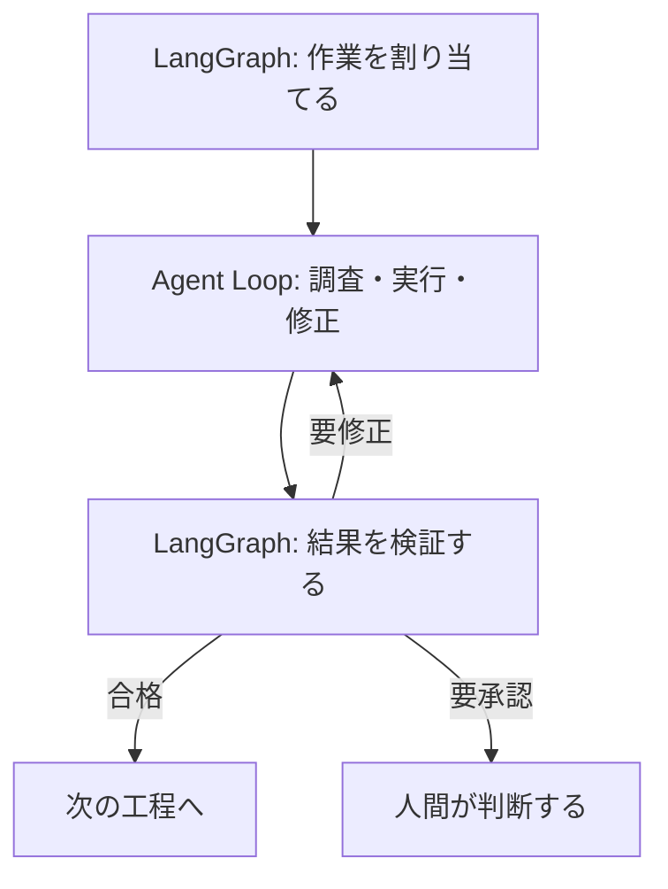

AIエージェントの実行管理では、**制御する部分と自由に考えさせる部分を分ける**ことが重要だと考えています。

そこで、外側をLangGraphで管理し、内側ではAIに試行錯誤させる構成を考えました。

## 2つの役割

**外側：LangGraph**

仕事全体の進行を管理します。

- 次の工程を決める
- 検証結果に応じて分岐する
- 再実行や停止を管理する
- 必要なら人間の判断を待つ

**内側：Agent Loop**

個々の仕事の進め方はAIに任せます。

- 状況を調べる
- 必要な操作を行う
- 結果を確認する
- 必要なら修正して繰り返す

## なぜ分けるのか

AIの行動をすべて事前に決めると、柔軟性が失われます。

一方、すべてをAIに任せると、停止条件や承認の管理が難しくなります。

**外側でルールを守り、内側では自由に試行錯誤する。**

この分担なら、AIの柔軟性を活かしながら、実行全体を管理できます。

## まとめ

LangGraphは工程の進行を管理します。内側のループは、各工程を達成するために試行錯誤します。

この2つを分けることで、**統制と自律性の両立**を目指せます。

なお、これは一つの設計案です。LangGraph自体もグラフ内の循環や条件分岐を扱えます。

## 参考資料

- [LangGraph公式 Overview](https://docs.langchain.com/oss/python/langgraph/overview)
- [LangGraph公式 Graph API](https://docs.langchain.com/oss/python/langgraph/use-graph-api)
