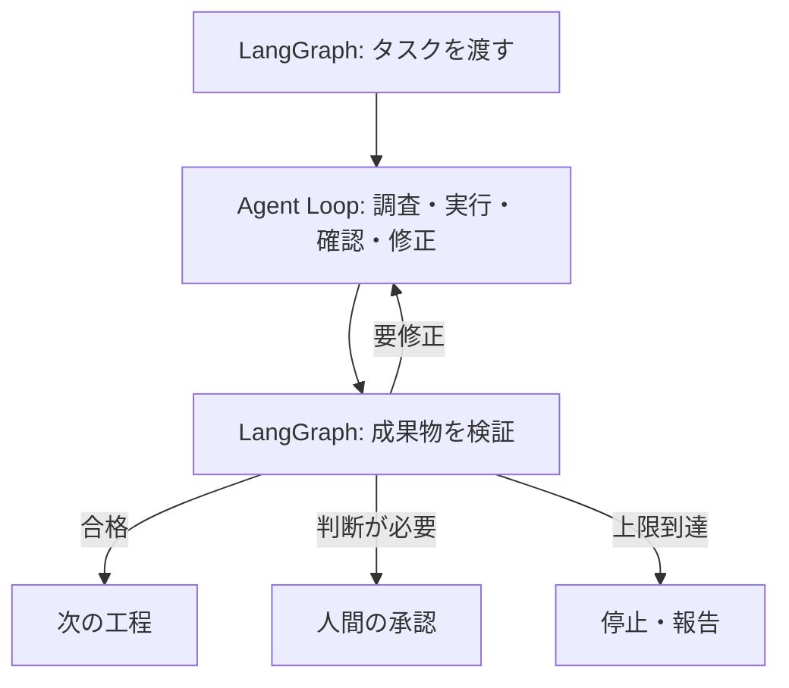

Anthropicは[Building effective agents](https://www.anthropic.com/research/building-effective-agents)で、**事前に定めた経路を進むWorkflow**と、**LLMが手順やツールを動的に選ぶAgent**を区別しています。前者は処理経路を制御しやすく、後者は想定外の手順にも対応できます。Anthropicは、複雑さを増やす前に単純な構成を検討することも勧めています。

では、この2つをどう組み合わせればよいのでしょうか。

この記事では、**外側の工程をLangGraphで管理し、内側の作業はAgent Loopに任せる**構成案を扱います。新しいアルゴリズムではなく、**自律的な作業と、明示的な検証・停止・承認をどう分離するか**が焦点です。

## 外側と内側で役割を分ける

**外側：LangGraph**

工程の進行と判断を管理します。例えば、タスクの割り当て、検証結果による分岐、再試行の上限、人間の承認です。

**内側：Agent Loop**

与えられた目的に向けて、AIが調査・実行・確認・修正を繰り返します。作業の手順を毎回固定する必要はありません。

LangGraph公式の[Thinking in LangGraph](https://docs.langchain.com/oss/python/langgraph/thinking-in-langgraph)でも、処理をノードに分け、共有する状態を設計し、エラーの種類に応じて再試行や人間への確認を行う考え方が示されています。

## なぜ全部をAIに任せないのか

例えば、AIに「不具合を修正して」と依頼したとします。

AIはコードを調べ、修正し、テストを実行します。しかしテストに失敗し続けたら、いつ止めるべきでしょうか。権限変更が必要になったら、誰が承認するのでしょうか。

これらまでAI自身の判断に任せると、**作業の成功条件と、作業を続けてよい条件**が混ざります。

そこで外側では「最大3回まで再試行」「検証に合格したら次へ」「権限変更は承認待ち」といったルールを持たせます。内側では、各試行でどのファイルを調べ、どう修正するかをAIに任せます。

**外側は成功条件と実行権限を管理し、内側は達成手段を探す。** これが設計の核です。権限変更が必要なら、作業を中断して承認を求めます。

## どんなときに分けるか

| 条件 | 構成の候補 |
| --- | --- |
| 手順も合格条件も固定 | 通常のプログラムや単純なWorkflow |
| 手順は探索が必要だが、外部承認は少ない | Agent Loop単体 |
| 工程間でテスト・承認・再試行予算を統一したい | 外側のWorkflow＋内側のAgent |

境界を増やすほど、状態の受け渡しと障害復旧は複雑になります。**最も単純な構成で要件を満たせるなら、二重構造は不要**です。

## 分けることで何が変わるか

外側のグラフには、タスクの状態、検証結果、再試行回数などを保持します。一方、内側のエージェントは作業中の調査結果やツール実行結果を扱います。

これにより、工程全体の進捗や停止理由を追いやすくなります。また、作業担当のモデルやツールを入れ替えても、外側の承認ルールを維持しやすくなります。

ただし、**LangGraphを使うだけで安全になるわけではありません**。検証条件、権限、停止条件は別途設計が必要です。内側の途中経過まで復旧したい場合は、内側にも状態保存の仕組みが要ります。LangGraphにはチェックポイント機能がありますが、外部API操作やファイル変更の副作用まで自動で取り消すものではありません。再実行時の重複操作を防ぐ設計も必要です。

LangGraph自体もループや条件分岐を表現できます。「外側」と「内側」は機能上の役割分担であり、必ずしも別プロセスや別フレームワークを意味しません。

## まとめ

外側のLangGraphで**工程と制約**を管理し、内側のAgent Loopで**手段の探索と実行**を行う。

これは新しいフレームワークの発明ではなく、既存のWorkflowとAgentを役割分担させる設計です。

採用基準は、**手段をAIに任せる必要があり、同時に検証・停止・承認を工程として明示したいか**です。

## 参考資料

- [Anthropic — Building effective agents](https://www.anthropic.com/research/building-effective-agents)
- [LangGraph — Thinking in LangGraph](https://docs.langchain.com/oss/python/langgraph/thinking-in-langgraph)
- [LangGraph — Persistence](https://docs.langchain.com/oss/python/langgraph/persistence)
