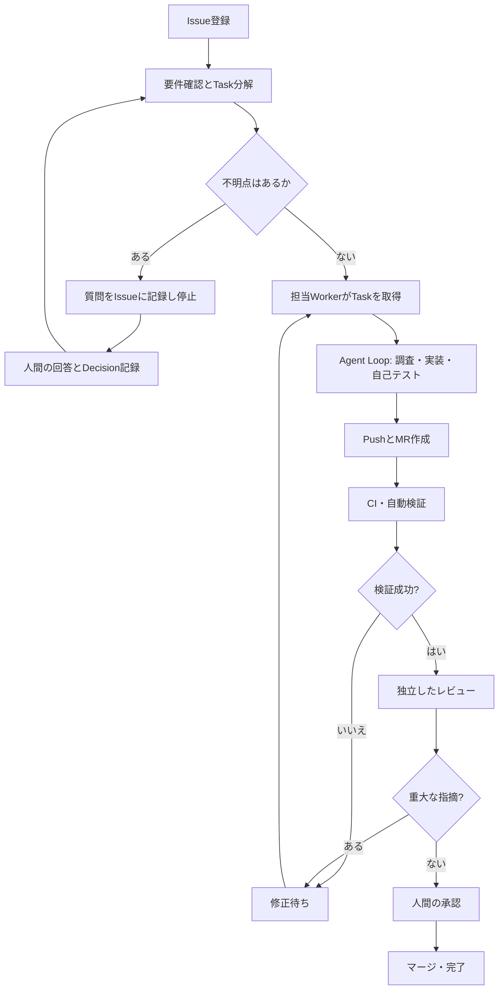
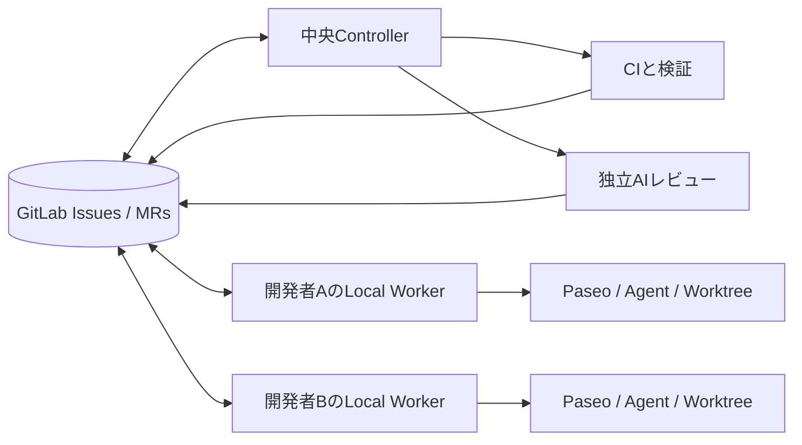

## はじめに

AIコーディングエージェントに「このIssueを実装して」と渡すだけでは、実装途中の質問、テスト失敗、レビュー指摘、担当者の不在などをまたいで作業を継続するのが難しいことがあります。

そこで、**外側でグラフが仕事の進行を管理し、内側ではエージェントが自由に調査・実装・修正を反復する**構成を考えました。

本記事は設計案です。実運用による性能改善や工数削減を実証したものではありません。具体的な組織・システムの設定を含まない、一般化した構成を示します。

## グラフで何を管理するのか

ここでいう「グラフ」は画面上のフローチャートだけではありません。**ノード（仕事や成果物）とエッジ（依存関係）を持つデータ構造**です。

| ノード | 役割 |
| --- | --- |
| Issue | 要件、担当者、受入条件 |
| Task | 実装可能な単位へ分割した作業 |
| Question / Decision | 不明点と、その回答・決定 |
| Workspace | 作業ブランチやGit worktree |
| AgentRun | エージェントの実行履歴 |
| MR | 差分とレビューの単位 |
| Verification | CI、テスト、確認結果 |

例えば `Task A → depends_on → Task B` は「Bが完了するまでAを開始できない」、`Question → blocks → Task` は「質問が解決するまで作業を停止する」と表現できます。

重要なのは、**GitLab IssuesとMerge Requestsを正本（source of truth）にする**ことです。グラフDBは参照や判断を高速化する派生データとし、GitLabから再構築できる設計にします。グラフ側とIssue側で別々の正解を持たせないためです。

## 外側のグラフと内側のループ

グラフは**次に誰が何をしてよいか**を決めます。一方、Agent Loopはタスク内部のファイル探索、コード編集、テスト実行、修正方針の選択を担います。

すべての思考ステップをグラフのノードに固定すると、モデルの柔軟性を損ない、保守する分岐が増えます。逆に全工程を自由なプロンプトだけで運用すると、承認漏れや重複着手を検出しにくくなります。**境界だけを明示的に制御する**のが狙いです。

## ローカルWorkerと中央サーバーを分離する

実装エージェントは各開発者のPCで動かし、中央サーバーは状態管理・検証・レビュー・通知に集中させます。

Local Workerは自分に割り当てられた着手可能なIssueを取得し、作業開始を記録してから、既存のPaseoセッションやworktreeを再利用してエージェントを起動します。PCがオフラインの間は実装を進めず、中央側はCIやレビュー結果を保持します。

この分離により、中央サーバーに各開発者のローカル環境を丸ごと再現させる必要がなくなります。ただし、**PCがオフの間も実装が進む構成ではありません**。

## 状態遷移と二重着手の防止

最小限の状態は以下のように整理できます。

| 状態 | 遷移条件 |
| --- | --- |
| 着手待ち | 依存Taskが完了、担当者が決定 |
| 実行中 | Workerが排他的に取得 |
| 検証中 | Push済み、CI・レビュー待ち |
| 修正待ち | CI失敗、重大なレビュー指摘 |
| レビュー待ち | 自動検証を通過 |
| 完了 | 必要な承認とマージが完了 |
| 回答待ち | 人間の判断が必要 |

`実行中` への遷移には、単純な「Issueのラベルを更新する」だけでなく、**競合に強い取得処理**が必要です。例えばControllerがタスク単位のlease（有効期限付き所有権）を原子的に付与し、Workerはlease IDと期限を定期的に確認します。

lease切れ後に別Workerへ再割当する場合も、旧Workerが遅れてPushしないよう、実行ID・ブランチ・MRを照合する必要があります。これは設計上の要件であり、単なる状態ラベルだけでは保証できません。

## テストはエージェントの自己評価から切り離す

「AIがテストに成功したと言った」ことと、「CIが期待したテストを再実行して成功した」ことは別です。

検証結果を `Verification` ノードとして保存し、実行したコマンド、対象コミットSHA、結果、成果物へのリンクを残します。レビューも実装エージェントとは分離し、重大指摘があれば `修正待ち` に戻します。

また、CIが成功しても仕様を満たすとは限りません。受入条件とテストの対応、手動確認が必要な箇所、マージ前の承認ゲートは残します。

## 段階的な導入

最初から複数エージェントを完全自律化するよりも、次の順に検証する方が故障箇所を特定しやすくなります。

1. **状態を見える化する**：Issue / MR / CIをグラフとして参照し、手動運用と整合するか確認
2. **Local Workerを導入する**：担当Issueを取得して作業を起動。マージは手動
3. **失敗から再開する**：CI失敗・レビュー指摘で既存worktreeに復帰できるか確認
4. **評価ハーネスを整備する**：同一タスクで試行を重ね、成功率・再試行数・レビュー指摘数を測定

## 何を計測するか

PoCでは少なくとも以下を記録します。

- Issue登録からMR作成までのリードタイム
- CI初回成功率と修正回数
- 人間によるレビュー指摘件数
- 二重着手・状態不整合の発生件数
- 人間の承認を必要とした判断と、その待機時間

**導入前後の比較データがなければ、効率化したとは結論づけません。** 自動化の複雑さや運用コストも含めて判断します。

## おわりに

グラフ管理の目的は、AIの行動を細かく縛ることではなく、**自由に実装してよい範囲と、客観的な検証・人間の判断が必要な境界を分けること**です。

次の記事では、このグラフの内部で動く「Agent Loop」を取り上げ、停止条件、再試行、コンテキスト管理、評価ハーネスを具体化する予定です。
