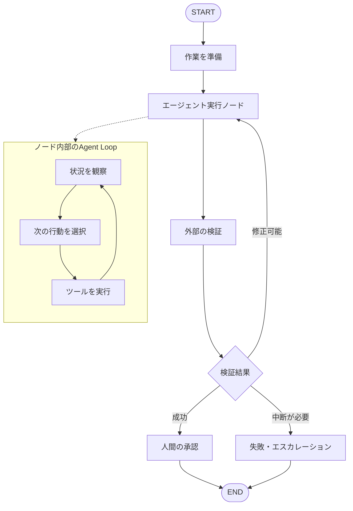

## はじめに

AIエージェントに長い仕事を任せると、二つの異なる問題が現れます。

1. **仕事全体をどう進めるか**：どの工程に進み、失敗時にどこへ戻り、どの時点で人間に判断を求めるか。
2. **一つの工程をどう完了させるか**：エージェントが調査・実行・観察・修正を繰り返し、結果を得るまでどう試行錯誤するか。

本記事では、**外側の実行管理をLangGraphに担当させ、内側の個々の作業ではエージェントに反復実行させる**設計を考えます。

ここでいう「ループエンジニアリング」は、本記事では**エージェントが目標達成に向けて、実行結果を観察しながら次の行動を選び直す反復処理を設計すること**を指します。標準化された単一の技術仕様や、特定ライブラリの正式な機能名として使っているわけではありません。

これはアーキテクチャの提案です。以下のコードは構成を示す最小例であり、実運用の成果や性能向上を実証したものではありません。

## 外側のグラフと内側のループ

まず役割を分けます。

| 層 | 責務 | 判断の例 |
| --- | --- | --- |
| 外側：LangGraph | 工程間の遷移、状態保持、中断・再開、実行結果に応じた分岐 | 「検証に失敗したので修正工程に戻す」「承認待ちにする」 |
| 内側：Agent Loop | 一つの工程内での調査、ツール実行、結果観察、再計画 | 「別のファイルを読む」「テスト結果から修正する」 |



※図中の内側ループは概念図です。LangGraphがノード内部のすべての思考やツール呼び出しを自動で制御する、という意味ではありません。

**外側は「いつ次の工程へ進めるか」、内側は「その工程をどう遂行するか」**に集中します。

## なぜ全部をLangGraphのノードにしないのか

エージェントのファイル読み込み、検索、コード編集、再検索までをすべて外側のグラフで固定すると、行動の選択肢をあらかじめ列挙する必要があります。

例えば、コードを直す工程では、実際にエラーを見て初めて必要な調査が決まることがあります。その部分は、エージェント自身が次の行動を選べる方が自然です。

一方、**承認を飛ばしてはいけない、失敗したら再検証する、一定回数で停止する**といった境界は、エージェントの自由な判断だけに委ねない方が管理しやすくなります。

ただし、LangGraphはノード内部にループを閉じ込める設計しかできないわけではありません。公式のGraph APIは、条件付きエッジや循環する遷移も扱えます。本記事の二層構造は、**責務分離のための一つの設計選択**です。

## LangGraphが外側で保持する状態

LangGraphの `StateGraph` では、ノードが共有状態を受け取り、変更するフィールドを返します。

外側で保持するのは、工程を判断するための**要約された状態**です。エージェントの内部メッセージや一時的な推論を、無条件に全部格納する必要はありません。

```python
from typing import Literal, TypedDict

class WorkflowState(TypedDict):
    task: str
    candidate: str
    verdict: Literal["pending", "passed", "retry", "blocked"]
    attempts: int
    feedback: str
```

- `task`：達成したい仕事
- `candidate`：エージェントが生成した成果物
- `verdict`：外部検証の判定
- `attempts`：外側の再実行回数
- `feedback`：次の試行に渡す具体的な指摘

内側のエージェントが何度ツールを呼んだかと、外側で何度工程をやり直したかは別の値です。両者を混同すると、停止条件を正しく設定できません。

## 最小構成：実行 → 検証 → 再実行

次の例では、`run_agent_loop` を**別途実装する関数**として扱います。LangGraphそのものがこの関数を提供するわけではありません。

```python
from langgraph.graph import StateGraph, START, END

MAX_ATTEMPTS = 3

def run_agent(state: WorkflowState) -> dict:
    # 自作または別ライブラリで実装するAgent Loop。
    # 1回の呼び出しの中で観察→ツール実行→再判断を反復する。
    result = run_agent_loop(
        task=state["task"],
        previous_feedback=state["feedback"],
        max_steps=20,
    )
    return {
        "candidate": result,
        "attempts": state["attempts"] + 1,
    }

def verify(state: WorkflowState) -> dict:
    # 検証処理もアプリケーション側で実装する。
    # 成果物のテスト・ルール検査などを実行する想定。
    ok, feedback = verify_candidate(state["candidate"])
    return {
        "verdict": "passed" if ok else "retry",
        "feedback": feedback,
    }

def route(state: WorkflowState) -> str:
    if state["verdict"] == "passed":
        return "done"
    if state["attempts"] >= MAX_ATTEMPTS:
        return "blocked"
    return "again"

builder = StateGraph(WorkflowState)
builder.add_node("run_agent", run_agent)
builder.add_node("verify", verify)
builder.add_node("blocked", lambda state: {"verdict": "blocked"})

builder.add_edge(START, "run_agent")
builder.add_edge("run_agent", "verify")
builder.add_conditional_edges(
    "verify",
    route,
    {
        "done": END,
        "again": "run_agent",
        "blocked": "blocked",
    },
)
builder.add_edge("blocked", END)

graph = builder.compile()
```

この例は、`run_agent_loop` と `verify_candidate` の実装を省略した**設計用コード**です。そのままでは実行できません。LangGraphのGraph APIで外側の遷移を記述する部分と、アプリケーション固有の内側の処理を意図的に分けています。

開始時には `candidate=""`、`verdict="pending"`、`attempts=0`、`feedback=""` などを渡します。

この構成では、内側の20ステップ上限と外側の3試行上限を独立して制御できます。ただし、20×3回のツール呼び出しが必ず起こるわけではありません。途中で終了することもあります。

## 内側のループは何を返すべきか

内側の実行を単に「成功しました」という文章で終わらせると、外側で客観的な判断ができません。

少なくとも次のような結果を扱えるインターフェースが望ましいでしょう。

```python
{
    "status": "completed",      # completed / blocked / budget_exceeded
    "artifact_ref": "path-or-id",
    "summary": "変更内容の要約",
    "steps_used": 12,
    "error": None,
}
```

これは**本記事で提案する返却形式**であり、LangGraphの必須スキーマではありません。

実運用では、実行ID、入力の識別子、成果物のバージョン、検証可能なログへの参照も持たせると、途中停止からの復帰や重複実行の判別がしやすくなります。

## 停止条件は二層で設計する

内側と外側で停止条件を別々に持たせます。

**内側の停止条件**

- 目標の達成、または作業不能の判定
- ツール呼び出し数・経過時間・トークン使用量の上限
- 危険な操作や権限不足を検出した場合の中断

**外側の停止条件**

- 独立した検証で合格した
- 工程の再実行回数が上限に達した
- 人間の承認・判断が必要になった
- 実行環境や依存サービスが復旧不能になった

ここで重要なのは、**内側のエージェント自身の「できた」という判断と、外側の検証結果を同一視しない**ことです。

例えばコード生成なら、エージェントの完了報告とは別に、テストや静的解析の結果で遷移を決めます。

## 中断・再開と副作用に注意する

LangGraphは、チェックポインタを設定した状態保持や、`interrupt()` による人間の入力待ちをサポートします。公式資料では、再開時に必要な `thread_id` の扱いも説明されています。

ただし、**外側のグラフが復元できることと、内側で実行していたエージェントの途中状態まで完全に復元できることは別**です。

ノードの途中で処理が失敗した場合、再実行時にそのノード内の副作用が重複する可能性を考慮しなければなりません。例えば、ファイル書き込みや外部APIへの送信には、冪等性キー、実行ID、成果物の存在確認などを組み合わせます。

長時間動く内側ループを一つの大きなノードに収める場合、LangGraphのチェックポイント境界が粗くなる点にも注意が必要です。内側の実行環境が独自に途中状態を保存できるかどうかで、復旧性は大きく変わります。

## この設計が向いている場面

外側の工程に明確なルールがあり、内側の解き方には自由度が必要な仕事に向いています。

例えば、次のような特徴を持つ作業です。

- 成果物を外部から検証できる
- 一回で完了せず、修正が必要になることがある
- 途中で人間の判断が必要になる
- 失敗時に工程単位で再実行したい
- 実行回数や使用量に上限を設けたい

逆に、単純な一回限りの処理では、LangGraphを導入することでかえって構成が複雑になる可能性があります。また、内側のループがブラックボックスになりすぎると、調査・復旧が難しくなります。

## まとめ

今回の設計の核心は、**制御すべき境界と、エージェントに探索を任せる領域を分けること**です。

- LangGraphは工程間の状態と遷移を管理する
- 内側のAgent Loopは一工程の中で自律的に試行錯誤する
- 外側の検証は、内側の自己申告とは分離する
- 停止条件、再実行上限、承認条件を明示する
- チェックポイントと内部状態の復旧範囲を混同しない

グラフがエージェントの全行動を決めるのでも、エージェントに全工程の管理を任せるのでもない。**外側は統制、内側は探索**という責務分離が、このアーキテクチャの出発点です。

## 参考資料（一次情報）

以下はいずれもLangChainによる公式ドキュメントです。LangGraphの実装仕様を確認する資料として参照しています。本記事の「外側／内側」という責務分離そのものは筆者の設計案です。

- [LangGraph Overview](https://docs.langchain.com/oss/python/langgraph/overview)：LangGraphの位置づけ、永続化・実行制御の概要
- [Use the Graph API](https://docs.langchain.com/oss/python/langgraph/use-graph-api)：`StateGraph`、ノード、条件付きエッジ、循環
- [Persistence](https://docs.langchain.com/oss/python/langgraph/persistence)：チェックポイントとスレッド単位の状態保持
- [Interrupts](https://docs.langchain.com/oss/python/langgraph/interrupts)：実行中断と人間の入力による再開
- [Thinking in LangGraph](https://docs.langchain.com/oss/python/langgraph/thinking-in-langgraph)：ノード粒度、エラー処理、状態設計の考え方
