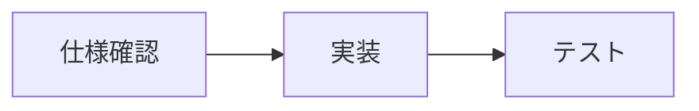
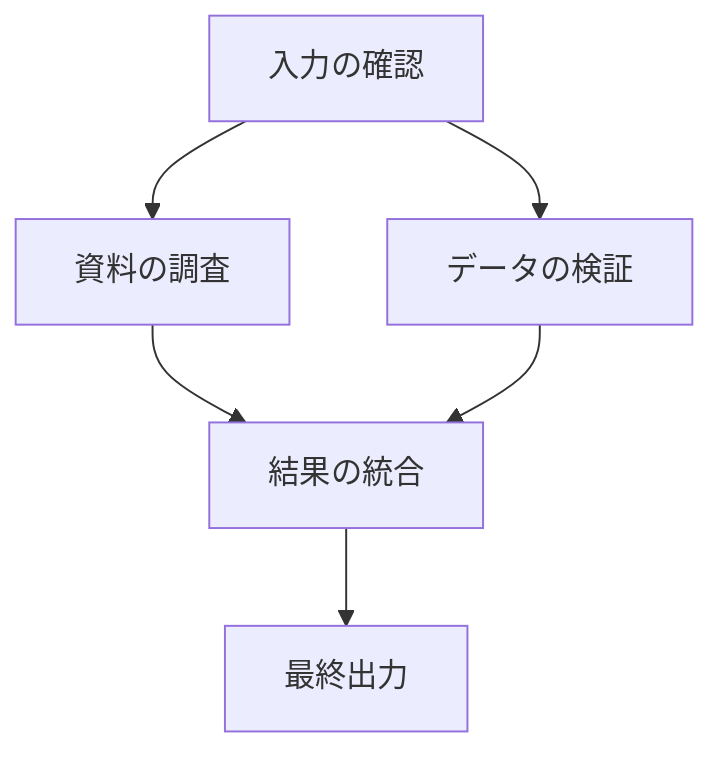
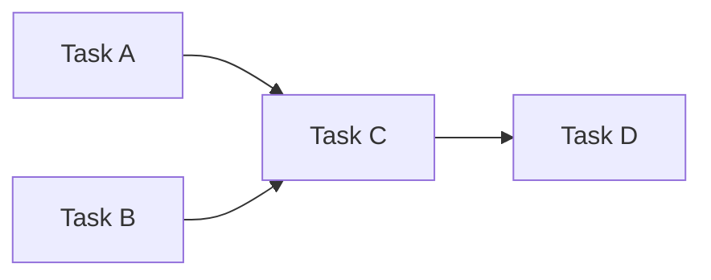
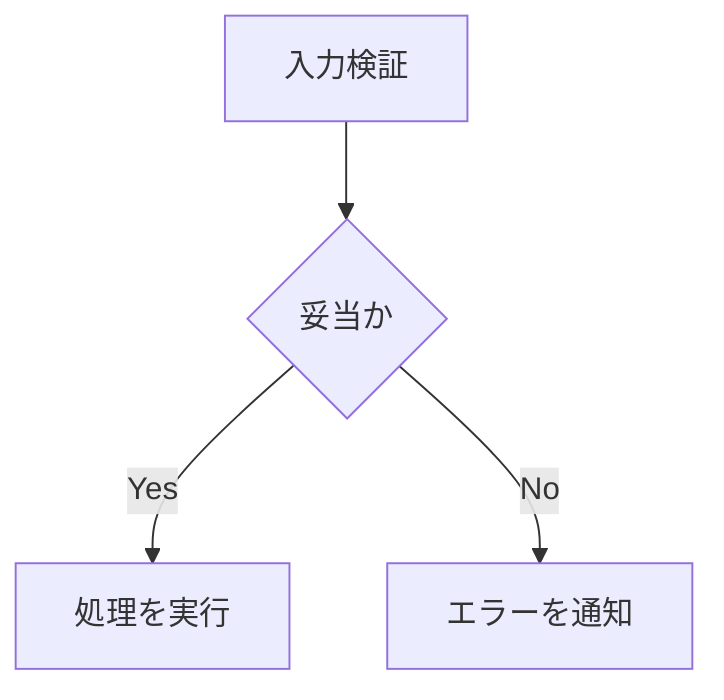

## はじめに

複数の仕事をAIエージェントに任せるとき、「何を先に実行するか」「どの仕事が別の仕事を待っているか」「失敗した仕事だけを再実行できるか」を表現する必要があります。

このような**仕事同士の関係を、ノードとエッジで表現して管理する方法**を、本記事では「エージェントのグラフ管理」と呼びます。

ここではグラフ管理という概念だけを扱います。特定のAI製品やフレームワーク、別の開発手法との組み合わせを前提にせず、データ構造、実行規則、設計上の難しさを順に整理します。

## 1. グラフとは何か

グラフは、頂点（vertex / node）の集合 `V` と辺（edge）の集合 `E` からなる構造で、一般に `G = (V, E)` と表します。

エージェントの実行管理では、次のように対応づけられます。

- **ノード**：実行する仕事、判断、入力、結果など
- **エッジ**：先行関係、依存関係、条件付きの遷移など

例えば「仕様を確認してから実装し、実装後にテストする」という処理は、次のように表現できます。



この図では、A・B・Cがノード、矢印が有向エッジです。矢印の向きに意味があるため、**有向グラフ（directed graph）**に分類されます。

ただし、矢印の意味は設計時に固定しなければなりません。「AからBに移動できる」という遷移なのか、「Bの実行にはAの完了が必要」という依存なのかを混在させると、実行規則が曖昧になります。

## 2. グラフと単純な手順書の違い

直列処理なら、配列に `[A, B, C]` と並べるだけでも十分です。

グラフが有効になるのは、**複数の仕事が分岐・合流し、互いに依存する**場合です。



BとCはAが終われば並列に実行できます。一方、DはBとCの両方が完了するまで開始できません。

この「両方を待つ」という条件は、エッジを描いただけでは自動的に決まりません。実行エンジン側に、**すべての前提ノードが成功したら開始する**などの明確な規則が必要です。

## 3. グラフの種類を区別する

「グラフで管理する」といっても、実際には複数のモデルがあります。

| モデル | エッジの意味 | 主な用途 |
| --- | --- | --- |
| 依存グラフ | 先行ノードの完了が必要 | 実行順序・並列化 |
| 状態遷移グラフ | 状態間を遷移できる | 実行状態の制御 |
| データフローグラフ | 出力が次の入力になる | データの受け渡し |
| 知識グラフ | ノード間の意味的な関係 | 情報の探索・関連づけ |

これらは似た図で表現できますが、同じものではありません。

特に、**依存グラフと状態遷移グラフを区別する**ことが重要です。「実装→テスト」という依存と、「実行中→失敗」という状態変化は、異なる次元の情報です。

本記事では以降、仕事の実行順序を表す**依存グラフ**を中心に考えます。

## 4. DAGと循環依存

依存グラフでよく使われるのが、**DAG（Directed Acyclic Graph：有向非巡回グラフ）**です。

DAGは有向グラフのうち、矢印をたどって元のノードに戻る経路が存在しないものです。



DAGであれば、**トポロジカルソート**によって依存関係を守る実行順序を求められます。順序は一意とは限りません。上の例ではAとBのどちらを先に実行しても構いません。

一方、AがBを待ち、BもAを待つ場合、どちらも開始できません。

```text
A depends on B
B depends on A
```

依存関係を追加する際には循環検出が必要です。例えば深さ優先探索（DFS）やKahnのアルゴリズムで循環の有無を検査できます。

なお、**グラフ一般がDAGでなければならないわけではありません**。循環を許す状態遷移グラフもあります。禁止すべきなのは、実行可能性を失わせる「依存関係としての循環」です。

## 5. 実行可能なノードをどう決めるか

各ノードに最低限、次の属性を持たせます。

| 属性 | 例 | 目的 |
| --- | --- | --- |
| `id` | `task-003` | ノードを一意に識別 |
| `kind` | `task` | ノードの種類 |
| `status` | `pending` | 現在の実行状態 |
| `depends_on` | `[task-001, task-002]` | 先行条件 |
| `attempt` | `1` | 実行回数 |
| `result_ref` | `artifact://...` | 出力の参照先 |

基本的な実行可能条件は、次のように表現できます。

```python
def is_ready(task, tasks):
    return (
        task["status"] == "pending"
        and all(
            tasks[dependency]["status"] == "succeeded"
            for dependency in task["depends_on"]
        )
    )
```

このコードは概念例です。実際には存在しない依存IDの検出、スキップされたノードの扱い、失敗時のポリシー、権限、同時実行数の制限などが必要です。

### AND条件とOR条件

「AとBの両方が成功したらCを実行」と「AまたはBのどちらかが成功したらCを実行」は異なります。

前者は全依存ノードの成功を待つ **AND join**、後者は条件を満たす経路のいずれかを受け入れる **OR join** と考えられます。

エッジだけでこれらを推測せず、`join_policy` などの属性として明示する方が安全です。

## 6. 条件分岐を表現する

依存グラフは実行順序を示しますが、処理結果に応じて実行するノードが変わる場合もあります。



この場合は、エッジに条件を付けるか、条件評価を専用ノードとして表現します。

ここで注意したいのは、**選ばれなかった分岐をどう扱うか**です。未選択ノードを永久に `pending` のままにすると、グラフ全体の完了判定ができません。未選択経路には `skipped` などの状態を与え、後続ノードがその状態をどう解釈するか定義します。

## 7. 並列実行と競合

依存関係のないノードは並列に実行できます。しかし、並列実行可能であることと、安全に並列実行できることは同義ではありません。

例えば、2つのノードが同じファイルや同じデータベース行を書き換える場合、競合する可能性があります。

そのため、依存関係とは別に、共有資源の排他制御や同時実行上限が必要です。

さらに、複数の実行Workerが同じ `pending` ノードを同時に見つけた場合、両方が着手する恐れがあります。

対策としては、トランザクションによる原子的な状態更新、比較更新（compare-and-swap）、lease（期限付き所有権）などが考えられます。**グラフ構造だけでは二重実行を防げません。**

## 8. 失敗したノードと後続ノード

依存先のノードが失敗したとき、後続をどう扱うかも重要です。

代表的な方針は次の3つです。

- **停止**：失敗ノードと、その成功に依存する後続ノードを停止する
- **再試行**：失敗ノードを条件付きで再実行する
- **代替経路**：別のノードを実行する

再試行では、実行回数、再試行間隔、タイムアウト、最終失敗状態を管理します。

また、外部システムへの書き込みを伴うノードでは、同じ処理を再実行しても副作用が重複しないよう、冪等性キーなどを検討する必要があります。

## 9. グラフをどこに保存するか

グラフ管理に専用のグラフデータベースが必須というわけではありません。

小規模な構成なら、JSONやSQLiteのテーブルでも十分表現できます。

```sql
CREATE TABLE tasks (
    id TEXT PRIMARY KEY,
    status TEXT NOT NULL
);

CREATE TABLE dependencies (
    task_id TEXT NOT NULL,
    depends_on_id TEXT NOT NULL,
    PRIMARY KEY (task_id, depends_on_id),
    FOREIGN KEY (task_id) REFERENCES tasks(id),
    FOREIGN KEY (depends_on_id) REFERENCES tasks(id)
);
```

この例では、`dependencies` がエッジの集合です。

ただし、このスキーマだけでは循環依存の禁止や実行状態の整合性までは保証できません。アプリケーション側の検証やトランザクション設計が必要です。

専用のグラフDBは、多段の関係探索や大規模な関連情報の検索が主要要件になった段階で比較すればよいでしょう。

## 10. グラフ管理のメリットと限界

### メリット

- **可視化**：実行順序、依存関係、停止箇所を追跡しやすい
- **並列化**：依存関係のないノードを識別できる
- **部分再実行**：失敗したノードと影響範囲を特定しやすい
- **監査性**：どの条件でノードが実行されたか記録できる

### 限界

- タスクの分割が不適切なら、グラフも不適切になる
- ノード数や分岐が増えると、設計・保守の負担が増える
- 外部副作用、競合、承認、権限の問題はグラフだけでは解決しない
- 動的にタスクが追加される場合、依存関係の再評価が必要になる

グラフ管理は万能な自律化手法ではなく、**実行関係を明示的に扱うためのモデル**です。

## まとめ

AIエージェントのグラフ管理を理解するうえで重要なのは、次の点です。

1. ノードは仕事、エッジは関係を表す
2. 依存グラフ・状態遷移グラフ・データフローグラフを混同しない
3. 依存関係にはDAGを使うと実行順序を決めやすい
4. 分岐・合流・失敗・並列実行の意味は別途定義する
5. グラフ構造に加えて、状態管理と競合制御が必要になる

まずは数個のノードで依存関係と実行可能条件を定義し、どのノードがいつ実行できるかを説明できることが、グラフ管理を設計する第一歩です。
