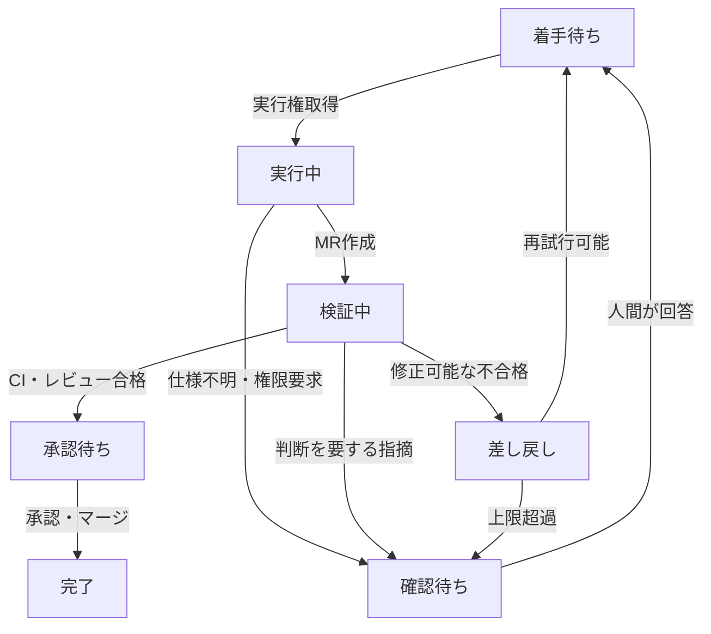

GitLabは[Issues](https://docs.gitlab.com/user/project/issues/)でタスクを管理し、[Issue Board](https://docs.gitlab.com/user/project/issue_board/)で工程を可視化できます。[Webhook](https://docs.gitlab.com/user/project/integrations/webhooks/)はIssueやMerge Request（MR）の変更を外部へ通知します。

AIエージェントを複数動かすなら、**「次に何を実行してよいか」を各エージェントの会話履歴ではなく、共有状態と検証結果から決める**必要があります。

前の記事「AI開発基盤を分散させる設計：ローカル実装と中央検証」では、各開発者のPCでAIが実装し、中央でCI・レビューを行う構成を紹介しました。今回はその続きとして、**Issueをタスク定義・進捗の正本にし、状態遷移を中央制御に限定する**構成を扱います。GitLabの標準機能だけで完結するものではなく、APIと制御サービスを組み合わせる設計案です。

## Issueに何を持たせるか

Issueには、実装前に決まっている情報と、実行中に更新される情報を分けて記録します。

| 種類 | 内容 |
| --- | --- |
| **タスク定義** | 目的、対象範囲、受入条件、優先度 |
| **担当と状態** | 担当者、現在の工程、ブロック理由 |
| **実行情報** | 実行ID、試行回数、開始・最終更新時刻 |
| **成果物** | 作業ブランチ、MR、対象コミット |
| **判定記録** | CI結果、レビュー結果、承認者、差し戻し理由 |

Issueは**タスク定義と共有する工程状態**の正本です。コードはGit、テスト結果はCI、レビューと承認はMRが正本です。Issueにはそれらのリンクと判定要約を残します。排他制御に使う短命な実行権（lease）は中央制御のデータストアで管理し、Issueの代替タスク台帳にはしません。

GitLabには[ラベルを使った工程管理](https://docs.gitlab.com/tutorials/kanban/)があります。例えば `status::ready`、`status::running` などで表示できます。ただし、相互排他的な**Scoped LabelsはPremium・Ultimateの機能**です。Freeや対応しないバージョンでは通常ラベルを使い、中央制御で「状態は1つ」の不変条件を検証します。

## 状態遷移は誰が決めるのか

状態を更新できる主体と条件を決めておきます。

| 遷移 | 必要な条件 | 実行主体 |
| --- | --- | --- |
| 着手待ち → 実行中 | 担当一致・実行権取得 | 中央制御（Workerの申請に応答） |
| 実行中 → 検証中 | MR作成・対象コミット確定 | 中央制御 |
| 検証中 → 承認待ち | 必須CI成功・重大指摘なし | 中央制御 |
| 検証中 → 差し戻し | CI失敗・修正可能な指摘 | 中央制御 |
| 実行中／検証中 → 確認待ち | 仕様不明・権限変更・人間の判断が必要 | 中央制御 |
| 承認待ち → 完了 | 最新のMR・必要な承認・マージ済みを確認 | 中央制御 |

**状態ラベルを変更するのは中央制御だけ**にします。WorkerやAIは着手・完了を申請し、中央制御が実際のMRやCIを再確認して遷移します。GitLabのラベル自体に任意の状態遷移ガードはないため、制御サービスで条件を検証します。人間が画面からラベルを直接編集できる場合もあるので、定期的な再照会で状態の不整合を検知します。

## 差し戻しと確認待ちは別物

例えば、テストで期待値との不一致が見つかり、修正方針が明確なら**差し戻し**です。中央制御は失敗したテスト、対象コミット、指摘内容をIssueに記録し、修正タスクとして再投入します。

一方、仕様に「割引は送料の前か後か」が書かれていない場合、AIが再実装を繰り返しても正解は決まりません。この場合は**確認待ち**にします。質問、選択肢、影響範囲、回答が必要な担当者をIssueに残し、回答まで実行しません。

判断ルールを整理すると、次のようになります。

- **差し戻し**：合格条件が明確で、再実装によって解決できる。
- **確認待ち**：合格条件や許可が未確定で、人間の判断が必要。
- **停止・調査**：環境障害、認証エラー、繰り返す同一失敗など、単純な再実行で改善しない。

AIレビューの指摘は、そのまま差し戻しを確定させません。再現できる不具合や明確な受入条件違反なら差し戻し、判断が割れる指摘なら確認待ちにします。単なるコメント数で合否を決めません。

差し戻しの情報は、**対象単位・判定・理由・証拠・修正範囲**で渡します。例えば「対象: 認証モジュール、判定: 不合格、証拠: リダイレクトのテストで期待302／実際200、修正範囲: 認証モジュール」のように記録します。独立した3件のうち1件だけが失敗したなら、原則その1件を再実行します。ただし、共通コードが原因なら影響する他の単位も再検証します。

## 無限ループと二重着手を防ぐ

「失敗したら着手待ちに戻す」だけでは、同じエラーを繰り返す可能性があります。そこで、**再試行の予算**を設定します。

例えば「同じ失敗は2回まで」「合計3試行で確認待ち」「CI環境障害は実装の再試行回数に含めず別途調査」といったルールです。回数は例であり、実際の値は運用データから調整します。

また、複数のWorkerが同じIssueを同時取得しないよう、実行IDと有効期限付きの実行権（lease）を管理します。ラベルの読み書きだけでは排他制御になりません。中央の制御サービスで**原子的な取得処理**を行い、実行権が失効した古いWorkerからの結果は受け付けない設計にします。実行権の確保後にIssue更新が失敗した場合は着手を許可せず、取得状態を解消します。

PCが停止した場合も、leaseが期限切れになれば再割当てできます。ただし、古い実行のPushやMR更新が残る可能性があるため、ブランチ・実行ID・コミットの照合が必要です。

## Webhookは通知、最終判定は再照会

GitLabの[Webhook](https://docs.gitlab.com/user/project/integrations/webhooks/)で、Issue、MR、Pipelineなどの変更を検知できます。

ただし、イベントの重複や順序のずれを考慮し、**Webhookの内容だけで状態を確定しません**。通知を受けた中央制御がGitLab APIから最新のIssue、MR、Pipelineを取得し、遷移条件を再評価します。

例えば、古いコミットのCIが成功しても、最新コミットのCIが未完了なら承認待ちには移しません。判定には**対象コミットSHAとPipeline ID**を紐づけます。

さらに、定期的な再照会で通知の取りこぼしや中央サービスの再起動に備えます。重複排除には、利用中のGitLabが提供するイベント識別子、またはIssue・状態・コミット等から作る処理キーを使います。Webhookのヘッダーはバージョンで異なるため、特定の識別子が常にあるとは仮定しません。

## 人間の判断を再開条件にする

例えば、仕様が曖昧な場合はIssueに「未決事項」「選択肢」「回答者」を記録し、**権限のある担当者が受入条件を更新するまで**再開しません。Issueのコメントに「進めて」と書かれただけでは、承認とみなしません。

再開時には、回答の反映先、再試行回数、実行権を確認します。人間の判断とAIへの指示を混同しないことが重要です。

## 失敗を次回の制約へ戻す

同じ種類の差し戻しが繰り返される場合、再試行回数を増やすだけでは根本原因が残ります。

例えば「共有APIの引数形式を誤解した」ことが確定したら、**受入条件・テスト・共通Skillのどこを修正するか**を検討します。変更には人間のレビューと版管理を挟み、確認できた教訓だけを次のタスクへ反映します。

Googleの[SREポストモーテム](https://sre.google/sre-book/postmortem-culture/)も、障害の原因を記録するだけでなく、再発防止策を実施することを重視しています。ここでの「次回への反映」はその考え方をAI開発に応用する**設計案**であり、AIが自動的に正しいルールを学習する機能ではありません。

## まとめ

Issueを正本にする目的は、単にタスクを一覧表示することではありません。

**実行条件、判断待ちの理由、検証結果、次の担当を、AIと人間が同じ状態から確認できるようにすること**です。

- Issueはタスクの正本、GitとCIとMRは成果物・検証・承認の正本
- 差し戻しは修正可能な不合格、確認待ちは人間の判断が必要な状態
- 中央制御が状態遷移を判定し、実行権・再試行予算・最新コミットを検証する

これにより、AIが各自のPCで自律的に実装しても、**開発全体の進行と品質ゲートを一貫したルールで管理する**構成を目指せます。

## 参考資料

- [Google SRE — Postmortem Culture: Learning from Failure](https://sre.google/sre-book/postmortem-culture/)
- [GitLab Docs — Issues](https://docs.gitlab.com/user/project/issues/)
- [GitLab Docs — Labels / Scoped Labels](https://docs.gitlab.com/user/project/labels/)
- [GitLab Docs — Issue boards](https://docs.gitlab.com/user/project/issue_board/)
- [GitLab Docs — Webhooks](https://docs.gitlab.com/user/project/integrations/webhooks/)
- [GitLab Docs — Merge request pipelines](https://docs.gitlab.com/ci/pipelines/merge_request_pipelines/)
- [GitLab Docs — Merge request approval rules](https://docs.gitlab.com/user/project/merge_requests/approvals/rules/)
