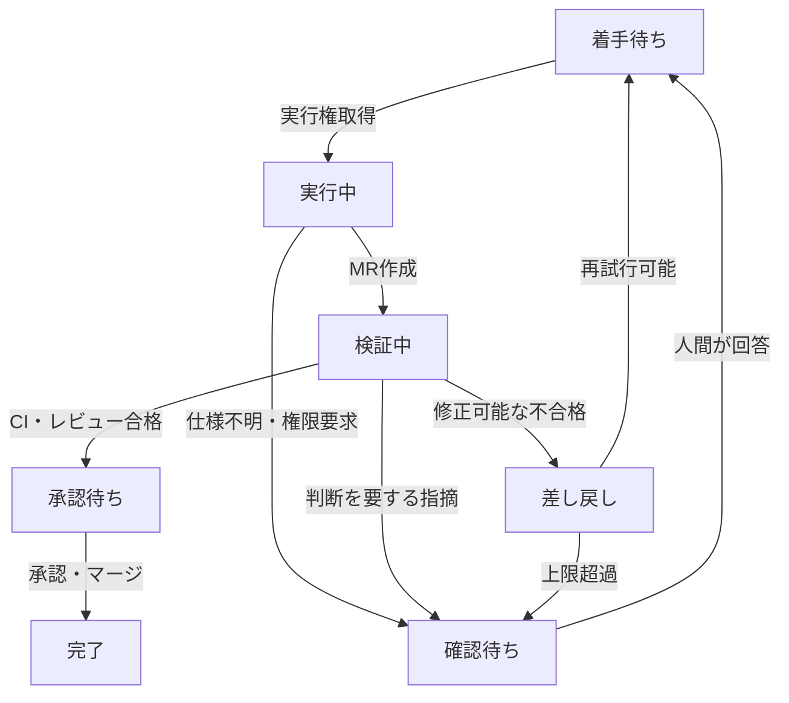

GitLabは[Issues](https://docs.gitlab.com/user/project/issues/)でタスクの担当者や議論を管理し、[Issue Board](https://docs.gitlab.com/user/project/issue_board/)で工程を可視化できます。さらに、[Webhook](https://docs.gitlab.com/user/project/integrations/webhooks/)を使えば、IssueやMerge Request（MR）の変更を外部のプログラムへ通知できます。

これらをAIエージェントの開発フローに組み込むとき、重要になるのは**「次に何を実行するか」をチャット履歴ではなく、共有されたタスク状態から決めること**です。

前の記事「AI開発基盤を分散させる設計：ローカル実装と中央検証」では、各開発者のPCでAIが実装し、中央でCI・レビューを行う構成を紹介しました。今回はその続きとして、**Issueをタスクの正本（Single Source of Truth）にする状態管理**を設計します。これはGitLabの標準機能だけで完成する仕組みではなく、APIと小さな制御プログラムを組み合わせる構成案です。

## Issueに何を持たせるか

Issueには、実装前に決まっている情報と、実行中に更新される情報を分けて記録します。

| 種類 | 内容 |
| --- | --- |
| **タスク定義** | 目的、対象範囲、受入条件、優先度 |
| **担当と状態** | 担当者、現在の工程、ブロック理由 |
| **実行情報** | 実行ID、試行回数、開始・最終更新時刻 |
| **成果物** | 作業ブランチ、MR、対象コミット |
| **判定記録** | CI結果、レビュー結果、承認者、差し戻し理由 |

Issueが「何を達成するか」の正本です。コードはGit、テスト結果はCI、レビューと承認はMRがそれぞれの正本です。**すべてをIssue本文に複製するのではなく、Issueから参照できるようにします。**

GitLabには[ラベルを使った工程管理](https://docs.gitlab.com/tutorials/kanban/)があります。例えば `status::ready`、`status::running` などで表示できます。ただし、相互排他的な**Scoped LabelsはGitLabのプランに制約**があります。利用できない環境では、通常ラベルと制御側の検証で一意性を守ります。

## 状態遷移は誰が決めるのか

状態を更新できる主体と条件を決めておきます。

| 遷移 | 必要な条件 | 実行主体 |
| --- | --- | --- |
| 着手待ち → 実行中 | 担当一致・実行権取得 | Local Worker |
| 実行中 → 検証中 | MR作成・対象コミット確定 | Worker／中央制御 |
| 検証中 → 承認待ち | 必須CI成功・重大指摘なし | 中央制御 |
| 検証中 → 差し戻し | CI失敗・修正可能な指摘 | 中央制御 |
| 実行中／検証中 → 確認待ち | 仕様不明・権限変更・人間の判断が必要 | 中央制御 |
| 承認待ち → 完了 | 必要な承認とマージを確認 | 中央制御 |

**状態変更の権限は工程ごとに分けます。** 実装担当のAIが自分のコードを「合格」「完了」と判定しない構成です。

## 差し戻しと確認待ちは別物

例えば、テストで期待値との不一致が見つかり、修正方針が明確なら**差し戻し**です。中央制御は失敗したテスト、対象コミット、指摘内容をIssueに記録し、修正タスクとして再投入します。

一方、仕様に「割引は送料の前か後か」が書かれていない場合、AIが再実装を繰り返しても正解は決まりません。この場合は**確認待ち**にします。質問、選択肢、影響範囲、回答が必要な担当者をIssueに残し、回答まで実行しません。

判断ルールを整理すると、次のようになります。

- **差し戻し**：合格条件が明確で、再実装によって解決できる。
- **確認待ち**：合格条件や許可が未確定で、人間の判断が必要。
- **停止・調査**：環境障害、認証エラー、繰り返す同一失敗など、単純な再実行で改善しない。

AIレビューの指摘は、そのまま自動的な差し戻し理由にしません。指摘の重要度、再現性、対象コードとの関連を検証し、誤検知を考慮します。

## 無限ループと二重着手を防ぐ

「失敗したら着手待ちに戻す」だけでは、同じエラーを繰り返す可能性があります。そこで、**再試行の予算**を設定します。

例えば「同じ失敗は2回まで」「合計3試行で確認待ち」「CI環境障害は実装の再試行回数に含めず別途調査」といったルールです。回数は例であり、実際の値は運用データから調整します。

また、複数のWorkerが同じIssueを同時取得しないよう、実行IDと有効期限付きの実行権（lease）を管理します。ラベルの読み書きだけでは排他制御になりません。中央の制御サービスで**原子的な取得処理**を行い、実行権が失効した古いWorkerからの結果は受け付けない設計にします。

PCが停止した場合も、leaseが期限切れになれば再割当てできます。ただし、古い実行のPushやMR更新が残る可能性があるため、ブランチ・実行ID・コミットの照合が必要です。

## Webhookは通知、最終判定は再照会

GitLabの[Webhook](https://docs.gitlab.com/user/project/integrations/webhooks/)で、Issue、MR、Pipelineなどの変更を検知できます。

ただし、イベントの重複や順序のずれを考慮し、**Webhookの内容だけで状態を確定しません**。通知を受けた中央制御がGitLab APIから最新のIssue、MR、Pipelineを取得し、遷移条件を再評価します。

例えば、古いコミットのCIが成功しても、最新コミットのCIが未完了なら承認待ちには移しません。判定には**対象コミットSHAとPipeline ID**を紐づけます。

さらに、定期的な再照会を併用すれば、通知の取りこぼしや中央サービスの再起動後にも状態を修復できます。状態更新と通知の重複処理を避けるため、イベントIDや実行IDを記録し、処理を冪等にします。

## まとめ

Issueを正本にする目的は、単にタスクを一覧表示することではありません。

**実行条件、判断待ちの理由、検証結果、次の担当を、AIと人間が同じ状態から確認できるようにすること**です。

- Issueはタスクの正本、GitとCIとMRは成果物・検証・承認の正本
- 差し戻しは修正可能な不合格、確認待ちは人間の判断が必要な状態
- 中央制御が状態遷移を判定し、実行権・再試行予算・最新コミットを検証する

これにより、AIが各自のPCで自律的に実装しても、**開発全体の進行と品質ゲートを一貫したルールで管理する**構成を目指せます。

## 参考資料

- [GitLab Docs — Issues](https://docs.gitlab.com/user/project/issues/)
- [GitLab Docs — Labels / Scoped Labels](https://docs.gitlab.com/user/project/labels/)
- [GitLab Docs — Issue boards](https://docs.gitlab.com/user/project/issue_board/)
- [GitLab Docs — Webhooks](https://docs.gitlab.com/user/project/integrations/webhooks/)
- [GitLab Docs — Merge request pipelines](https://docs.gitlab.com/ci/pipelines/merge_request_pipelines/)
