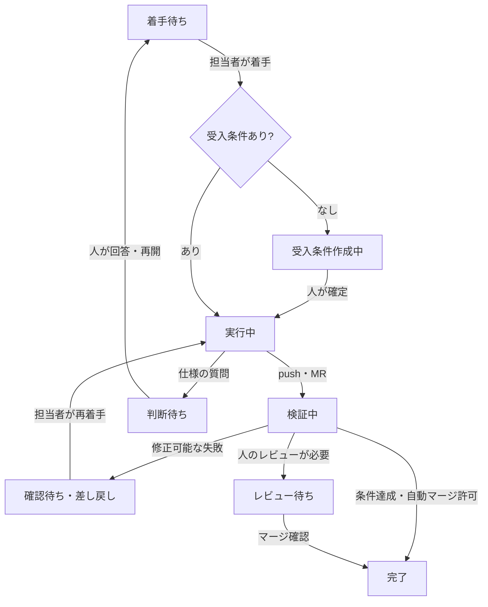

GitLabには[Issue](https://docs.gitlab.com/user/project/issues/)で仕事を記録し、[MR Pipeline](https://docs.gitlab.com/ci/pipelines/merge_request_pipelines/)で変更を検証する機能があります。ただし、**「どの条件でAIを再実行し、いつ人に判断を求めるか」までは決めてくれません**。

前の記事で紹介した「ローカル実装・中央検証」を、GitLabのIssueとプログラムによる状態管理で動かす構成を説明します。以下は**ローカルで検証した開発基盤を、機密を除いて一般化した実践例**です。GitLab標準機能と独自の制御ロジックは区別します。

## まず人が決めるのは、仕事と権限

タスクの単位を**1 Issue＝1作業ブランチ＝1 MR＝1 worktree**に揃えます。

依頼時の必須情報は、**タイトル、担当者、自動マージの可否**だけ。Issue本文に受入条件がなければ、担当者が着手した後、AIと対話して作ります。AIは既存コードを調べて候補を出しますが、実装前に人が条件を確定します。

| 正本 | 保持する情報 |
| --- | --- |
| Issue | 目的、担当者、受入条件、状態ラベル、判断・差し戻しの記録 |
| GitとMR | 変更内容、対象コミット、レビュー・マージの履歴 |
| CI | 構文・静的解析・テストなどの実行結果 |
| 制御プログラムのローカル情報 | 補助的な試行回数やエージェント実行情報 |

**Issueに全ログを複製しない**ことが要点です。IssueからMR・CI・作業記録に辿れるようにします。

## 状態を増やす理由は「次の担当」を分けるため

ここでいう**確認待ち**は、CI失敗や重大なレビュー指摘を受けた**修正の差し戻し**です。**判断待ち**は、仕様の質問や許可されていない操作への**人間の回答・承認**です。同じ「待ち」でも再開条件が異なります。

さらに、試行上限、環境障害、長時間の無更新などは**停止**として扱い、自動で繰り返さず理由を残します。ツール使用の承認はエージェント操作画面で受け、仕様についての回答は権限を確認したコメントを使います。

## 着手と状態遷移をどう制御するか

実践例では、担当者が手元の画面でIssueを選び、**自分のPCから着手**します。中央サーバーが全員のPCへ命令を送る方式ではありません。

担当者側の小さなプログラムが、担当者・現在状態を確認し、GitLabへ着手記録を残します。**競合した場合は記録順で先行した着手を有効**とし、後から着手した側はAIを起動しません。ラベル更新だけでは二重着手を防げないためです。

これは**中央のAPIやleaseを使った排他制御とは異なる方式**です。別PCの同時実行や通信障害への耐性は、実装上の不変条件と実機試験を分けて評価する必要があります。

制御プログラムはローカル側と中央側で役割を分けます。ローカルは着手、受入条件の確定、実装エージェントの監視、MRの作成まで。中央は検証中のIssueを確認し、CI・別コンテキストでのAIレビュー・マージ判定・放置検知を担当します。**状態の更新に毎回LLMを呼ぶ必要はありません**。

## 差し戻しは、修正材料とセットにする

CIが失敗した場合、中央はIssueに**対象コミット、失敗した検証、原因を調べるためのログ、指摘事項**を記録して差し戻します。担当者が再着手すると、同じ作業ブランチと、利用可能なら同じエージェントの会話を再利用します。

反対に「期待される動作が仕様にない」場合は、AIに修正を繰り返させず、人に質問します。受入条件を確定できてから再開します。

同じ失敗の連続回数や実装・検証の往復には上限を設けます。上限の数値そのものより、**何を同一失敗と数えるか、停止を誰が解除できるか**が設計上の重要点です。

## CI成功後も、すべてを自動マージしない

中央では、CI成功後に**実装とは独立したAIレビュー**を実行します。レビュー側には受入条件、差分、CI結果など必要な材料を渡し、実装中の会話は引き継ぎません。

自動マージは**依頼者の事前許可がある場合だけ**候補になります。さらに、受入条件の未達、重大指摘、権限・設定やデータ削除など高リスクの変更、必要なテスト不足があれば人のレビューに回します。許可がない場合も同様です。

マージの直前には**レビュー・検証したコミットSHAとの一致**を確認し、実装用と分離した権限でマージします。これは「レビューを省く」のではなく、**人がどの変更を判断するかをリスクで選別する**構成です。

## どこまで検証できたか

この構成のローカル検証では、**Issue作成→受入条件の対話と確定→実装→CI→独立レビュー→条件付き自動マージ→完了**まで、一件の小さな変更で通した記録があります。

一方、**本番サーバーへの常駐展開は未完了**です。異常系や別PCでの再開には仕様テストのみの項目があり、CI失敗からの再着手や長時間放置の処理もすべて実地検証済みではありません。自動マージの品質や費用対効果も、継続的な比較評価はこれからです。

この違いは重要です。**ローカルの成功例は、運用上の信頼性や本番導入効果を保証しません**。

## まとめ

Issueを正本にする価値は、AIの会話に頼らず、**誰が次に何をしてよいか**を再現可能な状態から決められることです。

着手・実装・検証・差し戻し・人の判断を分け、終了条件と証拠を残す。必要なところだけAIを使い、状態遷移はテスト可能なプログラムで扱う設計です。

## 参考資料

- [GitLab Docs — Issues](https://docs.gitlab.com/user/project/issues/)
- [GitLab Docs — Merge request pipelines](https://docs.gitlab.com/ci/pipelines/merge_request_pipelines/)
- [GitLab Docs — Labels](https://docs.gitlab.com/user/project/labels/)
- [Anthropic — Effective harnesses for long-running agents](https://www.anthropic.com/engineering/effective-harnesses-for-long-running-agents)
