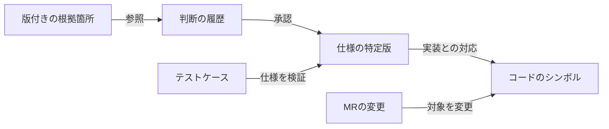
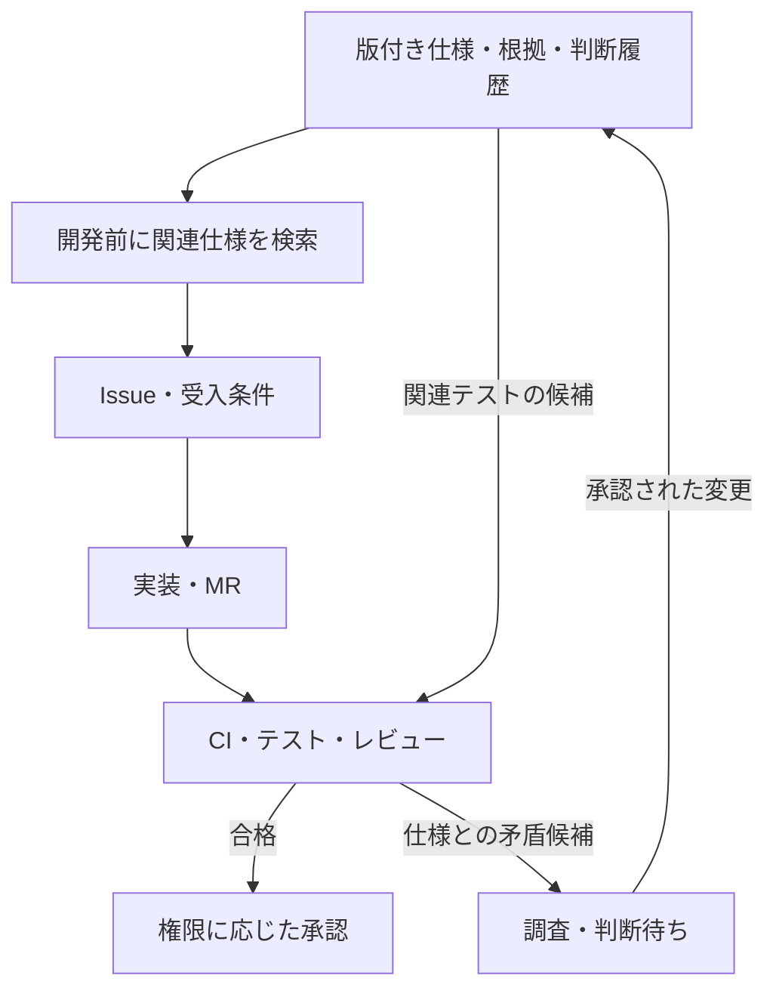

コードを変更するたびにテストを手で実行し、レビューで同じ確認を繰り返す。こうした負担には、テスト・CI基盤が効く。前編「AI開発基盤を分散させる設計：ローカル実装と中央検証」では、実装と独立した検証、差し戻し、マージ判定の仕組みを扱った。

では、**テストは自動化できても、「何が正しい仕様か」を毎回誰かに聞かなければならない場合**はどうだろうか。

開発負荷を減らすもう一つの柱は、**過去の調査と人間の判断を、根拠付きで蓄積し、次の開発で再利用すること**だ。本記事では、既存システムの知識を「仕様ナレッジ基盤」にする設計を紹介する。以下は**実装済みの成果ではなく、既存のCI基盤に追加するための設計案**である。

## 2本柱は、異なる種類の負担を減らす

| 柱 | 減らしたい仕事 | 自動化すること | 人間に残すこと |
| --- | --- | --- | --- |
| **テスト・CI** | 動作確認、機械的なレビュー、反復検証 | 構文・静的解析・単体／結合テスト、結果の記録 | 受入条件、変更リスク、最終的な承認 |
| **ナレッジ蓄積** | 仕様探し、同じ質問の繰り返し、変更影響の手探り調査 | 根拠付き検索、質問の重複統合、関連仕様・テストの候補提示 | 曖昧な業務判断、承認、例外の取り扱い |

重要なのは、**CIが成功しても、そのテストが「誤った仕様」を正しく検証している可能性がある**ことだ。逆に、正しい仕様が文書にあっても、それをチェックするテストがなければ実装の逸脱に気づきにくい。

目指すのは「AIにすべて判断させる」ことではない。**機械で調べられることは機械に任せ、人が判断した内容は再利用できる形で残す**ことだ。

## 仕様書を増やすだけでは、ナレッジにならない

長く改修されてきたシステムには、コード、Excel、議事録、チャット、過去の判断などに情報が分散しやすい。「どこかに書いてある」は「現在の変更に適用できる」と同義ではない。

特に危険なのは、**AIが既存コードを解析し、現在の挙動をそのまま「正しい仕様」と断定すること**だ。そこには長年放置された不具合や、顧客・バージョンごとの例外が含まれるかもしれない。

そこで、知識を少なくとも次の3軸で管理する。

| 軸 | 区別するもの |
| --- | --- |
| **根拠の種類** | コードで観測した（`code_observed`）、検証環境で再現した（`runtime_verified`）、権限者が業務上承認した（`domain_approved`） |
| **承認状態** | 候補（`candidate`）、確認待ち、承認済み、却下・旧版 |
| **適用範囲** | 対象製品・顧客・環境・リリース版・有効期間 |

例えば、架空の「未知のコードを含むCSVを取り込むとエラーになる」という挙動を発見しても、登録するのはまず**現行挙動の候補**だ。「CSV全体を中断すべきか」「該当行だけ除外するべきか」は、コードを読むだけでは決まらない。

AIは**分からないことを、分からないまま保存する**。これが後の誤回答や、誤った回帰テストの増殖を防ぐ。

## 根拠を「ファイル名」ではなく「版と位置」で保存する

検索結果に「仕様書に書いてありました」と表示するだけでは、更新後に同じ根拠を再現できない。**どの版の、どの箇所を読んで判断したか**を追える必要がある。

- **コード**：コミットSHA、ファイル、関数・シンボル、行位置
- **Excel**：原本の識別子、版ID、シート名、セル範囲
- **議事録・チャット**：記録ID、版や更新日時、該当節・メッセージ
- **テスト**：テストID、対象コミット、実行環境、結果
- **人の決定**：判断者の権限、日時、結論、適用範囲

OneDrive／SharePointでは、[Microsoft Graphのファイル版API](https://learn.microsoft.com/en-us/graph/api/driveitem-list-versions)で版履歴を取得できる。ただし、**過去版の保持期間は設定に左右される**ため、永続的な再現性は別途検討が必要だ。

知識の単位も分ける。業務全体を説明する**Feature**、条件と挙動を原子的に記す**Rule**、判断の履歴である**Decision**、未確定の論点である**Question**、根拠の特定箇所である**Evidence**を、それぞれ安定したIDで管理する。原本を無制限に複製するのではなく、権限付きの参照と必要最小限のメタデータを持つ。

## 依存グラフがあると「変更で何を見直すか」を逆引きできる

文書検索に加えて、**根拠 → 判断 → 仕様 → 実装 → テスト**の関係を型付きの依存グラフとして保存する。

例えばMRで関数が変更されたとき、グラフを逆引きして**関係しそうな仕様・テスト・判断履歴**を列挙できる。Excelの特定セルが改訂された場合も、そのセルを根拠とする仕様と、影響を受ける実装の候補を辿れる。

ただし、**「関係がある」は「変更で必ず壊れる」ではない**。エッジごとに、静的解析で観測した関係か、動作検証済みか、AIの推論かを保持する。グラフに経路が見つからなくても「影響なし」と断言しない。

ここでいう依存グラフは、前編の**AI作業の状態遷移を制御するGraphとは別物**だ。前者は「何と何が関係するか」、後者は「次に誰が何をするか」を扱う。

初期段階なら専用グラフDBを前提にせず、**PostgreSQLのノード・エッジテーブル**で始められる。検索もまず全文検索とメタデータ検索を用意し、必要性が見えた場合に意味検索を追加する設計とする。[PostgreSQLには全文検索機能](https://www.postgresql.org/docs/current/textsearch.html)があるため、初日から大規模RAGを組み立てる必要はない。

## 専門家への質問を「最後の手段」にする

この基盤の目的は文書を大量に作ることではない。**同じ判断を何度も人間に要求しないこと**にある。

質問が生まれたら、次の順に処理する。

1. **承認済みの仕様と適用範囲を検索**し、既存の判断で答えられるか確認する。
2. **同じ論点・同じ適用範囲の未解決質問を統合**し、別々のIssueから同じ質問を送らない。
3. **コード調査で解ける疑問を切り分け**、業務判断が本当に必要な場合だけ担当者へ送る。
4. **判断材料と選択肢を整理**し、人が回答したら権限・承認条件を確認して仕様の改訂案にする。

例えば、初回解析で不明点が50件見つかっても、それを50件の通知にはしない。今の変更を止める重要な判断だけを優先し、それ以外は質問台帳に保持する。

回答画面には、**選択肢に加えて「どれも違う」「保留」「自由記述」**を用意する。選択式カードは[Microsoft TeamsのAdaptive Cards](https://learn.microsoft.com/en-us/microsoftteams/platform/task-modules-and-cards/cards-and-task-modules)などで実装可能だが、**回答の送信と、正式な仕様承認は分離する**。

回答をそのまま既存仕様に上書きせず、誰が何を根拠に決めたかを履歴に残し、レビューを経て承認済み仕様に昇格させる。**承認済みでない要望や会議中の発言を、AIが勝手に確定仕様へ変えない**ことが重要になる。

## ナレッジとCIがつながると、判断の根拠も検証できる

2本柱をつなぐ接点は**Issue・MR・受入条件・テスト**だ。

[GitLabのMR Pipeline](https://docs.gitlab.com/ci/pipelines/merge_request_pipelines/)は変更のたびに検証を実行できる。そこへ仕様検索を加えると、「この変更はどの承認済みルールに関係するか」「対応するテストがあるか」「期待値が未確定ではないか」をレビュー材料にできる。

ただし、**仕様検索の一致だけで合否を決めたり、AIが提案したテストを無審査で正式な受入条件にしたりはしない**。仕様の候補、実装の観測結果、テストの合否、人の業務承認は、最後まで区別する。

## まず1機能で作り、専門家の負荷が減ったか測る

構築は段階的に進める。

- **最初**：代表的な1機能からコードの構造、仕様候補、版付き根拠、最小依存グラフを抽出する。専門家へ一括質問しない。
- **次**：GitLabで仕様・判断履歴をレビュー可能にし、検索API／MCPと根拠の逆引きを提供する。
- **その後**：質問の重複統合、必要な質問だけを送る回答フロー、MR差分からの関連仕様・テスト探索を追加する。

**GitLabは確定した仕様と判断履歴の正本**、**PostgreSQLは検索・依存グラフの投影と未解決質問の運用DB**と役割を分ける。検索用の派生データは再構築可能にし、顧客・プロジェクトの権限境界を越える検索を禁止する。MCPも接続手段にすぎず、個別の認可が不要になるわけではない（[MCPの認可仕様](https://modelcontextprotocol.io/specification/2025-11-25/basic/authorization)）。

測るべき成果は、生成文書数ではない。**専門家への問い合わせ件数、重複質問率、回答に要する時間、仕様起因の手戻り、根拠を再現できた割合、誤回答率**だ。導入前の値を測り、変更の規模・難易度を揃えて比較する。回答時間が減っても誤回答が増えるなら成功とは言えない。

## まとめ

CIは、**決められた期待値に対して実装を検証する**。ナレッジ基盤は、**その期待値の根拠と、過去に人が下した判断を再利用する**。

この2つが接続されれば、人間は毎回同じ仕様を探し直したり、同じ質問に答えたりする必要を減らせる可能性がある。

**人の判断をなくすのではなく、人が判断するべき新しい論点に集中できる状態を作る。** それが、テスト・CI基盤の次にナレッジ蓄積へ取り組む理由だ。

※本記事のナレッジ基盤は初期設計案であり、導入効果や本番運用を実証したものではない。記載した例は公開用に一般化した架空例である。

## 参考資料

- [GitLab Docs — Merge request pipelines](https://docs.gitlab.com/ci/pipelines/merge_request_pipelines/)
- [Microsoft Graph — List versions of a driveItem](https://learn.microsoft.com/en-us/graph/api/driveitem-list-versions)
- [Microsoft Learn — Cards and dialogs in Teams](https://learn.microsoft.com/en-us/microsoftteams/platform/task-modules-and-cards/cards-and-task-modules)
- [PostgreSQL — Full Text Search](https://www.postgresql.org/docs/current/textsearch.html)
- [Model Context Protocol — Authorization](https://modelcontextprotocol.io/specification/2025-11-25/basic/authorization)
