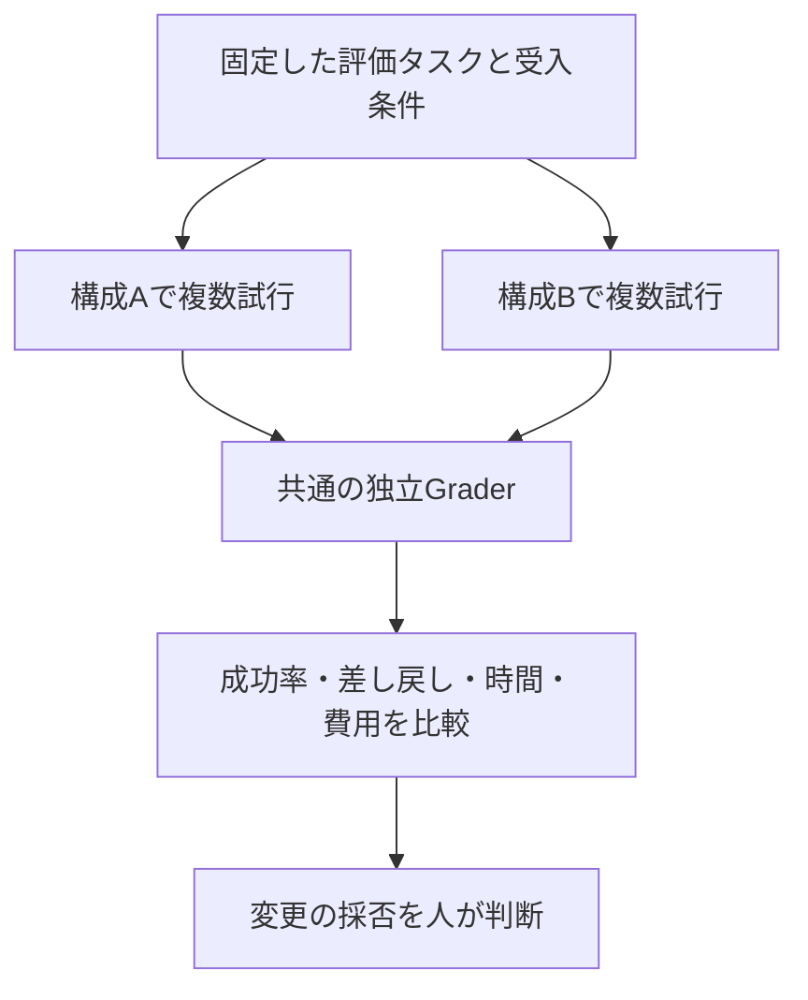

Anthropicの[Agent評価ガイド](https://www.anthropic.com/engineering/demystifying-evals-for-ai-agents)は、**Task・Trial・Grader・Transcript・Outcome**を分け、結果だけでなく実行過程を記録する方法を示しています。Googleも[ハーネス評価の技術記事（2026年9月）](https://developers.googleblog.com/en/the-anatomy-of-harness-engineering-how-to-evaluate-iterate-and-guard-ai-coding-agents/)で、総合スコアだけでは改善・悪化の理由が分からず、個別の振る舞いを評価する必要性を説明しています。

では、AIがコードを修正する開発基盤では、何を記録すればよいのでしょうか。

この記事では、**GitLab Issueを正本に、差し戻し回数・レビューチェック率・品質・時間・コストを集計し、ハーネスの変更前後を比較する**設計を紹介します。評価方式の提案であり、改善効果を実測した報告ではありません。

## 「作業が完了した」と「仕組みが優れている」は違う

前提とする構成は、**人が受入条件を確定し、ローカルAIが実装し、CIと別セッションのAIが検証する**開発フローです。状態遷移はLLMではなくプログラムが管理します。

この構成には、二種類の評価が必要です。

- **運用メトリクス**：実際のIssueで差し戻しや待ち時間がどれだけ生じたか。
- **比較Evals**：同じ課題を、ハーネスの異なる構成で繰り返したとき、どちらが期待する成果を出すか。

運用メトリクスは問題を発見するのに役立ちます。ただし、難しいIssueが増えただけでも差し戻し回数は増えます。**ハーネスの効果を測るには、課題とモデルなどの条件を揃えた比較が必要**です。

## まず指標の分母を決める

「差し戻しが3回」「チェック率90%」だけでは比較できません。対象期間・集計単位・分母を固定します。

| 指標 | 定義 | 読み方 |
| --- | --- | --- |
| **差し戻し経験率** | 1回以上差し戻された実行数 ÷ 全実行数 | 差し戻しがどれだけ広く起きたか |
| **平均差し戻し回数** | 差し戻し遷移の総数 ÷ 全実行数 | 1実行あたりの手戻り |
| **初回検証合格率** | 最初のCIと必須受入条件を通過した実行数 ÷ 全実行数 | 最初の提出の品質。検証に到達しない実行も不合格側に含める |
| **レビュー判定網羅率** | 証拠付きで合否を判定した必須項目数 ÷ レビュー実施試行の適用必須項目数 | レビューで確認漏れがないか |
| **受入条件適合率** | 合格と判定された必須項目数 ÷ レビュー実施試行の適用必須項目数 | 仕様を満たした割合。未判定は合格にしない |
| **最終タスク成功率** | 独立した最終判定で合格した実行数 ÷ 全実行数 | 完成した成果物が正しいか |
| **完了時間・費用** | 着手から完了までの時間、API利用量や費用 | 成果を得るまでの負担 |

*全実行数*には停止した試行も含めます。実運用で集計時点に進行中のものは**未完了として別欄に示し、成功率の比較では観測期間を揃える**必要があります。期限を決めた評価実験では、その期限内に完了できなかった試行を失敗として扱います。

レビューチェック率の分母は、**レビューを実施した試行の適用対象項目**です。CI失敗などでレビューに進めなかった件数は、別の「レビュー到達率」として記録します。適用対象外（N/A）の項目や、レビュー途中で追加した項目は混ぜず、受入条件の版を固定します。

また、**レビューチェック率100%は、レビューの正確さ100%を意味しません**。指摘が正しかったか、重大な欠陥を見逃したかは、人による確認や既知の不具合を含む評価課題で別に測定します。

## Issueの記録を集計可能なイベントにする

[GitLabのNotes API](https://docs.gitlab.com/api/notes/)でIssueのコメントを取得でき、[Pipelines API](https://docs.gitlab.com/api/pipelines/)では対象コミットのCI結果を取得できます。

実装・検証・差し戻しのたびに、次のフィールドを記録します。

| 項目 | 内容 |
| --- | --- |
| 識別子 | プロジェクト、Issue、実行ID、試行番号、イベントID |
| 条件 | モデルの版、ハーネスの版、受入条件の版、評価器の版 |
| 時系列 | UTC時刻、開始・検証・差し戻し・待機・完了 |
| 検証 | コミットSHA、Pipeline ID、必須CI結果、受入条件ごとの合否と証拠 |
| コスト | トークン数・費用、処理時間、人間の待ち時間 |
| 差し戻し | 原因区分（実装・仕様不明・環境・レビュー指摘）、再試行回数 |

例えば、次のような**架空のレビューレコード**を保存します。

```json
{
  "trial_id": "demo-01",
  "head_sha": "example-sha",
  "review": {
    "required_checks": 4,
    "checked_with_evidence": 3,
    "passed": 2,
    "failed": 1,
    "unknown": 1
  },
  "redo_count": 1
}
```

この場合、**レビュー判定網羅率は3÷4＝75%、受入条件適合率は2÷4＝50%**です。未判定1件は「合格」になりません。ここでの数値は計算例であり、実際の測定値ではありません。

重要なのは、**Issueコメントの件数をそのまま差し戻し回数にしない**ことです。状態が「検証中→差し戻し」へ遷移した事実を数え、同じイベントの再処理・重複通知はイベントID等で排除します。CIも、**レビューしたHEADのSHAとPipeline IDが一致する結果だけ**を対象にします。

実装側で失敗したケースと、CI環境の障害や人間の仕様判断待ちは分類しておきます。これを混ぜると、ハーネスの品質以外の要因で差し戻し率が変化します。

## レビューの精度は「網羅率」と別に測る

レビューが全受入条件を埋めても、誤判定する可能性があります。既知の欠陥を含む課題や専門家が判定したサンプルを使い、次も確認します。

- **重大欠陥の検出率（Recall）**：見つけた真の重大欠陥数 ÷ 評価集合内の真の重大欠陥数
- **重大指摘の適中率（Precision）**：真の重大欠陥だった指摘数 ÷ 重大指摘の総数

真の欠陥を網羅的に確認していない通常の運用ログだけでは、Recallの分母が分かりません。レビュー担当AIの「重大0件」を、欠陥が存在しない証明として扱わないことが重要です。AIを採点に使う場合も、人手の判定との定期的な照合が必要です。

## 同じタスクでハーネスの差を測る

構成A（最小限の安全対策を備えたAgent）と、構成B（追加のSkills・Hooks・検証フローを備えたAgent）を比較します。



比較時には、**モデルの版、タスク、開始時点のコード、テスト用DB、制限時間、権限・安全対策、採点基準を揃えます**。各試行はクリーンなworktree・データから開始し、前の試行の修正を引き継がせません。同じタスクでも出力が変わるため、複数のTrialを行います。

受入条件はAIに実装させる前に固定し、採点は**実装したAIの自己申告ではなく、独立したテスト・成果物**を中心に行います。Anthropicも、結果を直接確認できる評価と複数Trialを重視しています。

比較では、平均値だけでなく**成功数／試行数、差し戻し回数の分布、時間の中央値、費用の分布**を併記します。タスクの難易度別に集計し、差の不確実性も確認します。少数の試行で得られた差を、統計的に確立した改善と断定しません。

なお、BでツールとCIとPromptを一度に変更すれば、どれが効果を生んだか特定できません。改善要因を知りたい場合は、**Skillsだけ変更、Hooksだけ変更**などの段階的な比較も行います。

## 指標を最適化しすぎない

差し戻しが少なくても、検証が甘ければ良い結果ではありません。逆に、厳しいテストを追加すると、初期の差し戻し回数は増えることがあります。

そのため、**差し戻し回数だけを最小化しない**設計にします。まず最終タスク成功率や重大欠陥の見逃しを確認し、その品質を維持できた構成同士で手戻り・時間・費用を比較します。

集計を改善に結びつける流れは次のとおりです。

1. Issue・CI・レビューの記録から、再現可能な実行データを作る。
2. 失敗した試行を原因別に分類し、タスクやGraderの誤りも点検する。
3. ハーネスの改善案を**一つずつ**適用して比較Evalsを再実行する。
4. 良くなった指標だけでなく、悪化した指標も残す。

## まとめ

ハーネスの評価は、**「AIが何回働いたか」ではなく、「どの条件で、どの品質の成果を、どれだけの手戻りとコストで得たか」**を測ることです。

GitLabの状態遷移とレビュー結果は、運用メトリクスの出発点になります。ハーネスの改善効果を判断する段階では、**同一課題・複数試行・独立Grader**による比較が必要です。

ここで示したのは**測定設計**です。実際の差し戻し率、レビュー精度、改善率を算出したものではありません。

## 参考資料

- [Anthropic — Demystifying evals for AI agents](https://www.anthropic.com/engineering/demystifying-evals-for-ai-agents)
- [Google Developers Blog — The Anatomy of Harness Engineering](https://developers.googleblog.com/en/the-anatomy-of-harness-engineering-how-to-evaluate-iterate-and-guard-ai-coding-agents/)
- [OpenAI — Testing Agent Skills Systematically with Evals](https://developers.openai.com/blog/eval-skills)
- [OpenAI Cookbook — Build an Agent Improvement Loop](https://developers.openai.com/cookbook/examples/agents_sdk/agent_improvement_loop)
- [GitLab Docs — Notes API](https://docs.gitlab.com/api/notes/)
- [GitLab Docs — Pipelines API](https://docs.gitlab.com/api/pipelines/)
