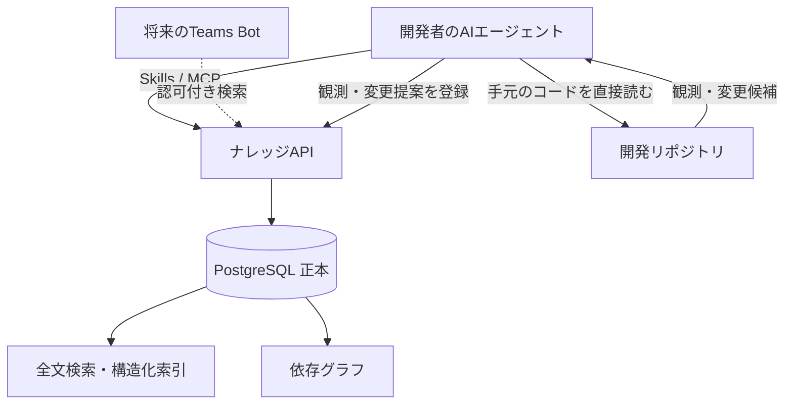
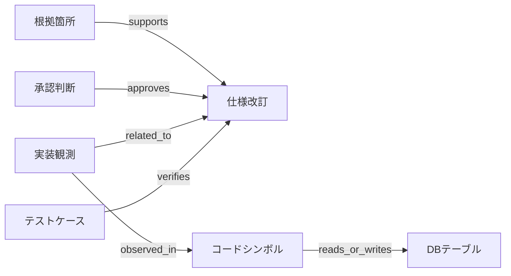
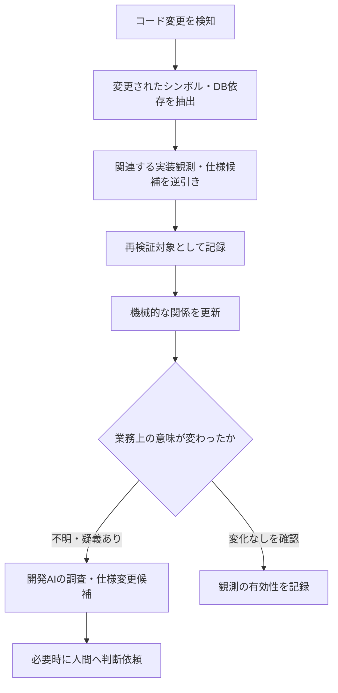

既存システムの改修では、コードを読めば「現在どう動くか」は調べられても、**「なぜその仕様になったのか」「どの条件で正しいのか」**まで分かるとは限らない。

仕様はコード、Excel、議事録、チャット、担当者の記憶に分散する。担当者に質問して解決したとしても、その判断が記録されなければ、次の改修で同じ質問が繰り返される。

そこで、**過去の調査結果と正式な業務判断を、根拠・適用条件・改訂履歴とともに再利用するためのナレッジ基盤**を考える。

本記事は、そのアーキテクチャと運用方針を整理した設計例である。実際の本番導入効果や業務回答精度を実証した報告ではない。

## ナレッジベースとRAGは同じものではない

RAG（Retrieval-Augmented Generation）は、検索などで取得した外部情報をLLMの回答に利用する手法だ。一方、業務ナレッジ基盤には、検索以前に解くべき問題がある。

- その情報は、コードの**観測結果**なのか、正式に**承認された仕様**なのか
- 顧客・環境・リリース・日付のどの条件で有効なのか
- 誰が、何を根拠に、いつ判断したのか
- 元資料や実装が変更されたとき、何を再確認すべきか
- 回答できない場合、どの質問を誰に委ねるか

検索手法だけを高度化しても、古い仕様や未承認の観測を優先してしまえば誤回答は防げない。

**RAGはナレッジを利用するための一部であり、ナレッジ基盤は知識の確定・保守・統制まで扱う**という位置付けにする。

## 3層に分けて知識を蓄積する

知識は大きく3層で管理する。

| 層 | 管理する内容 | 代表的な問い |
| --- | --- | --- |
| **承認済み業務仕様** | 業務ルール、判断表、適用条件、改訂・承認履歴 | 本来どう動くべきか |
| **実装観測ナレッジ** | 条件分岐、例外、SQL、データ更新、副作用、処理経路 | 現在のコードはどう動くか |
| **依存グラフ・根拠** | 仕様、関数、DB、テスト、資料の関係 | どこを根拠とし、何に影響するか |

重要なのは、**コードを解析して得られた事実を、そのまま正しい業務仕様へ昇格させないこと**だ。

例えば、架空のCSV取り込み処理で「必須項目が欠けた行だけを除外する」という分岐が見つかっても、それはまず「コードで観測された挙動」として保存する。「CSV全体を中断すべき」という正式仕様が別に存在する可能性があるからだ。

両者が異なる場合は、矛盾として調査対象にする。AIによる推測で、承認済み仕様を上書きしない。

## 保存粒度は「業務上意味のある条件分岐」

仕様を機能単位の概要文だけで保存すると、「ある項目が空欄ならどうなるか」のような具体的な質問に答えにくい。

特に、将来的にTeamsから利用するBotは、開発者の手元にあるリポジトリを直接読めるとは限らない。したがって、中央には**条件・入力・挙動・例外・副作用を独立して検索できる粒度**で記録する。

例えば実装観測の概念モデルは次のようになる。

```yaml
observation_id: OBS-CSV-001
feature: csv_import
status: code_observed

condition:
  required_field: missing

behavior:
  action: reject_record
  scope: current_row
  side_effects:
    - error_count_incremented

source:
  repository: application
  commit: "<commit-sha>"
  file: "application/models/Import_model.php"
  symbol: "validateRow"

verification:
  method: static_analysis
  reviewed: false
```

これは架空の例であり、実装DBの物理スキーマを指定するものではない。

記録対象は、業務上意味のある正常系・異常系の分岐、入力条件、権限制御、データ更新、例外・副作用、関連するコードとSQLなどだ。一方、全ソースコードや全ASTをそのまま複製することは原則として目的にしない。

**詳細に残すことと、無制限に複製することは違う。** 将来の質問に必要な意味情報と出典を選んで構造化する。

## PostgreSQLを正本とし、検索索引は派生データにする

承認済み仕様、仕様改訂、判断履歴、判断表、変更提案、質問、監査記録の正本をPostgreSQLに集約する。

GitLabはコード、MR、開発用Skills、必要に応じた変更イベントの管理に利用するが、仕様の正本を二重化しない。



PostgreSQL内の役割は、おおむね次のように分ける。

| 領域 | 保存する情報 |
| --- | --- |
| `core` | 仕様ID、不変改訂、出典メタデータ |
| `workflow` | 質問、変更提案、承認、発効状態 |
| `rules` | 版付き判断表、委譲ポリシー |
| `graph` / `search` | 依存関係と検索用の投影 |
| `ops` | 監査、イベント、索引更新水位 |

検索は、まず適用条件による構造化検索、PostgreSQLの全文検索、必要に応じた文字列類似検索などから始める。日本語の分かち書きや検索品質は別途検証が必要だ。ベクトル検索は、意味的な検索漏れが問題になった段階で導入を検討する。

PostgreSQLには[全文検索](https://www.postgresql.org/docs/current/textsearch.html)と[行単位セキュリティ](https://www.postgresql.org/docs/current/ddl-rowsecurity.html)がある。ただし、権限制御はDB設定だけで完結させず、API・検索結果・キャッシュまで一貫して適用する。

## 「最新の仕様」は1つとは限らない

業務仕様の改訂を単純な最新版ポインタだけで管理すると、顧客別の例外や段階的なリリースで破綻する。

例えば、同じ仕様IDでも次のような状況はあり得る。

| 適用条件 | 有効な仕様 |
| --- | --- |
| 顧客A・旧リリース | エラー時にファイル全体を中断 |
| 顧客A・新リリース | エラー行だけ除外 |
| 顧客B・現行リリース | エラー行を保留して後続処理 |

検索APIは、仕様IDに加えて**顧客・環境・リリース・有効日時**を使って適用版を解決する。過去の判断を再現する必要があれば、当時システムに記録されていた内容を区別する時点情報も扱う。

そして、次の3つは別の状態として管理する。

1. **承認**：業務上、この内容を正式な仕様として認めたか
2. **発効**：どの対象・日時から適用する仕様か
3. **実装適用**：対象システムに実際に反映されたか

承認された仕様が、すべての環境へ即時に反映されるとは限らない。適用条件が不足して版が一意に決まらなければ、AIは推測せず確認を求める。

## 根拠の所在を記録する。ただし原本は複製しない

根拠は「ファイル名」だけでなく、可能な範囲で特定箇所まで記録する。

- **コード**：リポジトリ、コミットSHA、パス、シンボル、行位置
- **Excel**：元の保存場所、シート名、セル範囲
- **議事録・Teams**：元のメッセージや資料の識別子、該当節
- **判断**：判断者、権限、日時、結論、適用対象

ここでは、Excel・録音・議事録などの**原本を別の保管先へコピーせず、移動先も追跡しない**設計を採用する。

そのため、出典の参照可否は明示的に区別する。

| 状態 | 意味 |
| --- | --- |
| `available` | 記録した元の場所で確認できた |
| `missing` | 元の場所に見つからない |
| `access_denied` | 権限不足で確認できない |
| `modified_or_version_unknown` | 当時と同じ内容か分からない |
| `check_failed` | 通信・サービス障害などで確認できない |
| `not_checked` | 未確認 |

**所在を記録するだけでは、将来の原本再現を保証できない。** 元資料が消失・上書きされた場合は、関連仕様を直ちに削除するのではなく、出典の確認不能状態と再確認の必要性を記録する。

この制約を隠さず回答に反映することが、存在しない原本を参照したかのように説明することより重要だ。

## 依存グラフで変更の影響候補を辿る

仕様、コード、DB、テスト、根拠を型付きのエッジで接続する。



例えば、特定の関数が改修されたとき、その関数を根拠にした観測情報、関連業務ルール、参照DB、テストを逆引きできる。

ただし、「グラフ上でつながっている」ことと「実際に影響がある」ことは同義ではない。関係ごとに**静的解析・実行時検証・AI推定・人間承認**といった導出方法を残し、未検出を「影響なし」と断定しない。

初期構成では専用グラフDBを必須とせず、PostgreSQLのノード・エッジテーブルで扱う。

## AIが行う調査と、人間が行う判断を分ける

開発者のAIエージェントは、ナレッジAPIをMCP経由で参照し、不足する情報は**手元のソースコードを直接調査する**。

そこで得られた内容は、出典付きの実装観測や仕様変更候補として中央APIへ戻せる。

一方、将来のTeams Botはコードに直接アクセスできない構成を想定する。そのため中央に詳細な実装観測を蓄積する。検索しても回答に十分な情報が見つからなければ、担当者へ調査を依頼し、根拠のない回答を作らない。

この構成では、開発者の探索を代替する専用の中央LLM調査ワーカーは標準構成に置かない。ただし、**コード構造や依存関係を抽出する静的解析処理は維持する**。直接調査と定期的な構造抽出は異なる役割だからだ。

中央API自体にはLLMを常駐させない。MCPはAIとツールを接続する手段であり、仕様の承認権限を付与する仕組みではない。認可・監査はサーバー側で強制する。

MCPの仕様は進化しているため、実装時は[公式仕様](https://modelcontextprotocol.io/specification/2026-07-28)に基づいて利用するトランスポート・認可方式を確認する。

## 判断表はLLMに毎回解釈させない

承認済みの業務ルールのうち、条件と結果を決定的に表現できるものは、判断表として保存・評価する。

例えば「入力項目Aが空欄で、種別Bなら保留」といったルールだ。

判断表には、入力の型、適用条件、有効版、優先順位、境界条件、矛盾時の扱いを定義する。

AIは判断表の候補を提案できるが、**正式承認と発効は別のワークフローで行う**。評価APIも、未承認・対象外・入力不足・複数ルールの競合時に勝手なデフォルト値を選ばない。

判断権限は、既存仕様の提示、承認済みルールの適用、新規業務判断、契約・高リスク判断といった段階に分ける。緊急度と承認権限を混同しない。

この仕組みの狙いは、同じ判断を繰り返し専門家へ問い合わせる負担を減らし、**新しい論点だけを判断してもらう**ことにある。

## 細かなナレッジほど、鮮度管理が必要になる

詳細な条件分岐を蓄積すると、コード変更後に古い観測が残るリスクも増す。

対策として、コードと観測情報の対応にコミットSHAやシンボル識別子を含め、変更時には関連する情報を再検証対象にする。



全項目を毎回再解析するのではなく、変更に関係する範囲を優先する。解析が追いついていなければ、検索APIは対象のコード版や索引の鮮度を返す。

また、仕様の登録数を成果指標にしない。**検索されない情報、根拠の弱い情報、重複する観測を増やすほど、保守費用と誤回答リスクが増える**からだ。

## 導入は1機能の縦切りから始める

最初から全リポジトリの業務知識を完全に抽出しようとすると、確認できない判断が大量に積み上がる。

まずは1つの代表機能に絞り、次の流れを通す。

1. コードから分岐・例外・DB更新・依存を抽出する
2. 出典付きの実装観測と仕様候補をPostgreSQLへ登録する
3. 仕様の改訂・承認・有効版解決を試す
4. MCPを通じて開発AIが検索・追加調査できるようにする
5. コードを直接読めない利用者を想定し、APIの検索結果だけで説明できる範囲を調べる
6. コード変更による陳腐化・矛盾検出と回答保留を試す

Teams連携は、ナレッジAPIと独立した後付け可能な入力経路として扱う。試作段階では開発AI＋MCPを優先し、必要に応じて軽量なWeb画面で変更提案・承認を確認する。

業務専門家に追加の正答集作成や網羅的な回答精度評価を要求しない方針を採る場合でも、**認可、仕様版の選択、承認状態、判断表、データ整合性、障害時の動作は自動テストで検証する**。業務回答精度が未測定であることは明記する。

本番のLLM契約、バックアップ・復旧目標、運用責任は試作後に責任者と合意する。試作が動いたことと、本番運用に耐えることは別の判断だ。

## まとめ

ナレッジ基盤で再利用したいのは、単なる文章ではない。

**「どの条件で、何が起き、なぜそれが正しいと判断され、どのコードや資料を根拠としているか」**という、将来の変更に耐える知識である。

そのために、承認済み仕様と実装観測を分け、詳細な条件分岐と依存関係を蓄積し、PostgreSQLで版・適用条件・承認履歴を管理する。

開発AIは手元のコードを直接探索できる。将来のチャットBotはそれができない。この違いを埋めるのは、中央でLLMを常駐させることではなく、**コードを読めない利用者にも必要な根拠と挙動を届けられるナレッジの設計**だ。

人の判断をなくすのではなく、一度確定した判断を繰り返し求めない仕組みを目指す。

---

## 参考資料

- [PostgreSQL公式ドキュメント — Full Text Search](https://www.postgresql.org/docs/current/textsearch.html)
- [PostgreSQL公式ドキュメント — Row Security Policies](https://www.postgresql.org/docs/current/ddl-rowsecurity.html)
- [MCP公式仕様 — 2026-07-28](https://modelcontextprotocol.io/specification/2026-07-28)
- [Microsoft Learn — TeamsのBot / エージェントの会話スコープ](https://learn.microsoft.com/en-us/microsoftteams/platform/bots/bot-basics)
