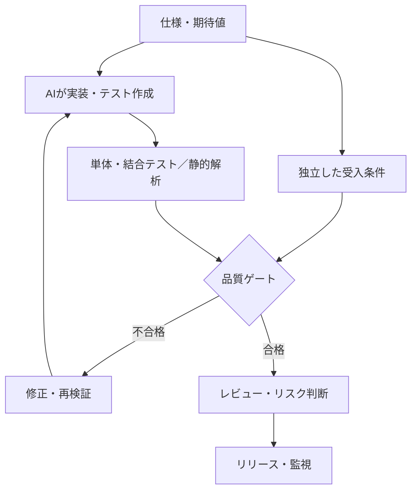

GitHubは[Copilotの責任ある利用に関する文書](https://docs.github.com/en/copilot/responsible-use/agents)で、AIによるコードレビューには**見逃しと誤検知がある**と説明し、人間による確認を推奨しています。

一方、人間によるレビューも欠陥の完全な検出を保証しません。**「誰が見たか」だけでは、コードの正しさは保証できません。**

この記事の問いは、**AI生成コードを何の証拠で受け入れるか**です。テストやレビューは既存の手法です。新たな論点は、コードとテストの両方をAIが作れる環境で、**仕様から独立した合格基準をどう残すか**にあります。

## 一つのチェックを信用しすぎない

Googleは[テスト戦略に関する技術記事](https://testing.googleblog.com/2015/04/just-say-no-to-more-end-to-end-tests.html)で、ユニットテスト、結合テスト、E2Eテストの役割を説明しています。E2Eだけに頼ると、実行が遅く、失敗原因も特定しにくくなります。

AIが生成したコードでも、異なる観点のチェックを組み合わせることが重要です。

それぞれの役割は異なります。

- **ユニットテスト**：個々の処理が期待どおり動くか
- **結合・E2Eテスト**：機能やユーザー操作が成立するか
- **静的解析・セキュリティ検査**：実行テストとは別の欠陥がないか
- **AI・人間によるレビュー**：仕様、設計、変更意図とのズレがないか

同じ仕様の誤解を共有した検査を何個増やしても、その誤解は見つかりません。**検査の数だけでなく、期待値をどこから得るか**が重要です。

Anthropicの[Agent評価ガイド](https://www.anthropic.com/engineering/demystifying-evals-for-ai-agents)は、実行中の発言やツール操作の記録（Transcript）と、環境に残った実際の結果（Outcome）を区別しています。例えば「修正完了」と報告した事実と、対象のテストが成功し必要な変更が反映された事実は別です。

## テストが通っても間違う例

例えば「商品価格から10%割引し、最後に送料500円を加える」という仕様を考えます。

商品価格10,000円なら、正しい請求額は9,500円です。

ところがAIが「送料を加えてから10%割引」と誤解すると、9,450円を返すコードを書くかもしれません。さらに同じ解釈でテストを作れば、**間違ったコードなのにテストは成功します**。

実装を生成する前に、受入条件へ「商品10,000円、送料500円なら請求額は9,500円」と記録しておきます。テスト生成に同じAIを使っても、**期待値を実装から逆算しない**ことが重要です。

もちろん、仕様そのものが間違っていれば、これでも防げません。最終的には、利用者が求める振る舞いを定義できているかも確認する必要があります。

## 合否をどう判断するか

検査は「すべて通ったか」だけでは不十分です。**機械的に判定できる合格条件を先に決め**、失敗の種類に応じた判断を行います。例えば必須テストの終了コード、検査対象のコミット、変更可能なファイル範囲です。「AIが自信ありと答えた」は検証結果になりません。

| 状況 | 判断の例 |
| --- | --- |
| 必須テストが失敗 | 修正して再検証。原則マージしない |
| セキュリティ上の重大な懸念 | 専門家が確認するまで停止 |
| 仕様が曖昧で期待値を決められない | 受入条件を確定するまで確認待ち |
| 検査を通過 | 残存リスク、変更範囲、承認条件を確認してリリース判断 |

合格条件を満たした後も、**変更が間違っていた場合の影響範囲と、元に戻せるか**で確認の深さを変えます。例えば文言修正と本番データを削除する変更では、同じ「テスト成功」でも必要な承認が異なります。これは具体的な運用設計例であり、すべての変更を一律に分類できるわけではありません。

NISTの[Secure Software Development Framework（SSDF）](https://csrc.nist.gov/pubs/sp/800/218/final)も、脆弱性の低減だけでなく、見逃した問題の影響軽減や原因への対処を扱っています。これは**セキュリティ開発の指針**であり、すべての品質問題が解決するという意味ではありません。

## 実践例：検証結果をマージ条件へつなぐ

匿名化したPHP開発基盤のローカル試験では、**受入条件を人が確定してから実装**し、MRに構文チェック、静的解析、単体テスト、使い捨てDBを使うテストなどを適用しています。一部の対象では依存関係のセキュリティ検査も行います。

CIを通過した変更だけに、**実装とは別セッションのAIレビュー**を実行します。受入条件を項目ごとに確認し、重大な不一致は差し戻します。人が事前に許可した変更でも、設定・認証・削除処理など影響の大きい箇所やテスト不足があれば、人のレビューへ回す設計です。

ローカルでは小さな変更の自動マージまで確認していますが、**本番運用における欠陥の検出率や品質向上を示すデータはまだありません**。検証を設計したことと、その効果を測定したことは区別します。

## 人間の責任はどこにあるか

人間のレビューも完璧ではありません。検査結果と承認記録を残し、問題が発生した際に判断を追跡できるようにします。

AI生成コードを受け入れる際の責任を、次の3つに整理できます。

1. **仕様を決める**：何を満たせば正しいのかを明確にする。
2. **検証の仕組みを整える**：どのチェックを通すか、何を見逃し得るかを把握する。
3. **判断と結果に向き合う**：残るリスクを理解してリリースし、問題が起きたら対応する。

品質保証の検査は、**無欠陥を証明するものではありません**。

リリース前には、リスクに応じた検証と承認を行い、判断根拠を記録します。リリース後に問題が見つかれば、影響を抑え、修正し、再発防止につなげます。これは、すべての欠陥を事前に発見できないことを前提とした運用です。

人間のレビューを廃止する話ではありません。変更の危険度に応じて、専門家による確認や追加テストが必要です。Googleの[コードレビュー指針](https://google.github.io/eng-practices/review/reviewer/looking-for.html)でも、テストの妥当性、設計、動作をレビュー対象に挙げています。

## まとめ

AIのコードを無条件に信じる必要はありません。同時に、人間の目を絶対視する必要もありません。

**仕様を定め、異なる観点から検証し、根拠を持って判断する。問題が起きたら対応し、検証の仕組みを改善する。**

AIによる実装を運用に組み込むには、コードレビューだけでなく、**仕様・検証・承認・障害対応を一体で設計すること**が必要です。

## 参考資料

- [GitHub Docs — GitHub Copilot Agents: Limitations](https://docs.github.com/en/copilot/responsible-use/agents)
- [Google Testing Blog — Just Say No to More End-to-End Tests](https://testing.googleblog.com/2015/04/just-say-no-to-more-end-to-end-tests.html)
- [NIST — Secure Software Development Framework（SP 800-218）](https://csrc.nist.gov/pubs/sp/800/218/final)
- [Google — What to look for in a code review](https://google.github.io/eng-practices/review/reviewer/looking-for.html)
- [Anthropic — Demystifying evals for AI agents](https://www.anthropic.com/engineering/demystifying-evals-for-ai-agents)
