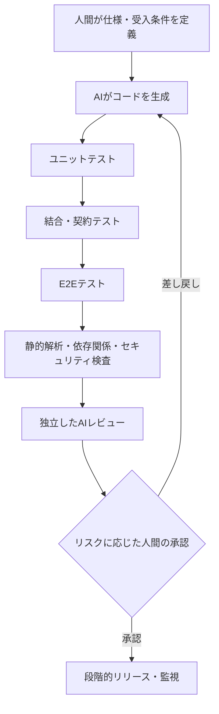

## はじめに

AIが大量のコードを生成できるようになるほど、人間が変更差分を一行ずつ読み、すべてを理解してからリリースする運用は難しくなる。

では、AIが書いたコードをどのように信用すればよいのだろうか。

私は、**コードを生成した主体を信用するのではなく、仕様への適合を検証する仕組みを信用できる状態にする**ことが重要だと考えている。

そのために、ユニットテスト、結合テスト、E2Eテスト、静的解析、セキュリティ検査、AIレビュー、人間の判断を組み合わせる。どれか一つを万能の審査員にするのではなく、異なる種類の失敗を発見できる多層のチェックを設計する。

これは「人間がコードに責任を持たなくてよい」という主張ではない。むしろ、人間が責任を果たすための**仕事の中心が、実装の逐語的な確認から、仕様・受入基準・検証基盤の設計へ移っていくのではないか**という仮説である。

## 「動くコード」と「正しいコード」は違う

例えば、ECサイトの割引計算を考える。

仕様が「商品小計から10%割引し、その後に送料を加える」であるとき、商品小計10,000円、送料500円なら請求額は9,500円になる。

ところが、AIが「商品小計と送料の合計から10%割引する」コードを書いたとする。請求額は9,450円となり、コードは例外を出さずに動くかもしれない。しかし仕様には違反している。

しかも、AIが自分の解釈に合わせてテストも作れば、その誤った計算を「正常」と判定する可能性がある。

ここには二つの異なる問いがある。

- **Verification（検証）**：実装が定められた仕様・設計に従っているか
- **Validation（妥当性確認）**：その仕様や成果物が、そもそも利用者のニーズを満たしているか

テストがすべて通っても、期待する振る舞いを仕様に書き漏らしていれば、正しい製品とは限らない。

## 信頼は一回のレビューではなく、多層の証拠からつくる

この図は論理的な検査の層を示したもので、実際のCIでは複数の検査を並列実行してもよい。重要なのは、**それぞれが何を検出でき、何を検出できないか**を明確にすることだ。

### 1. ユニットテスト：小さな振る舞いを検証する

ユニットテストは、関数やクラスなどの小さな単位の振る舞いを高速に確認できる。

割引計算なら、通常値だけでなく、端数、ゼロ円、境界値、不正な入力などを検証する。

ただし、AIがコードとテストの両方を同じ誤解に基づいて生成すれば、両方が誤っていてもテストは成功する。**期待値をどこから導くか**が重要になる。

例えば、仕様書に明記した「小計10,000円、送料500円、10%割引なら9,500円」という受入例を、実装とは独立にテストへ落とし込む。

### 2. 結合・契約テスト：境界での不一致を検出する

個々の関数が正しくても、API、DB、外部サービスとの連携が正しいとは限らない。

リクエスト形式、データ型、エラー時の応答、トランザクションの境界などを確認する。API契約やスキーマの変更は、単体テストだけでは検出できないことがある。

### 3. E2Eテスト：利用者の操作を通して確認する

E2Eテストは、実際の利用者に近い経路でシステム全体の振る舞いを検証する。

例えば「商品をカートに入れ、割引を適用し、注文確認画面に9,500円が表示される」まで確認する。

ただしE2Eテストは一般に実行時間や保守コストが大きく、失敗箇所の切り分けも難しくなりやすい。**すべての検証をE2Eへ寄せるのではなく、各層の役割を分ける**。

Google Testing Blogでも、ユニット・結合・E2Eのテストピラミッドが説明されている。比率は固定の正解ではなく、システム特性に応じて調整する必要がある。

### 4. 静的解析・セキュリティ検査：テスト以外の欠陥を探す

型チェック、Lint、静的解析、依存パッケージの脆弱性検査、秘密情報の混入検出などは、実行時テストとは異なる観点を提供する。

ただし、これらを通過したことは「脆弱性がない」ことの証明ではない。設定ミス、権限の過大付与、業務上の不正な操作など、別途確認が必要な問題もある。

### 5. AIレビュー：仕様・設計とのズレを別の視点で探す

AIレビューは、コード生成とは別の実行・別のコンテキストで行うことに価値がある。

ただし、**別のAIを使えば独立性が保証されるわけではない**。同じ仕様の誤読、同じ欠落した情報、類似のモデル特性によって、生成側とレビュー側が同じ誤りを見逃すことがある。

レビューには、少なくとも次の情報を渡したい。

- 変更目的と受入条件
- 変更前後の差分
- 影響するAPI・データ・権限
- 実行したテストとその結果
- 過去の不具合や設計上の制約（共有可能な範囲）

AIレビューの指摘も**検証対象の仮説**として扱う。指摘が正しいかを確認し、重要な問題は再現テストへ落とし込む。

## 多層化しても「全部同じ誤りを見逃す」ことがある

チェックを5層に増やしても、すべてが同じ誤った仕様を前提にしていれば、同じ欠陥を見逃す。

信頼性を高めるために必要なのは、単なるチェック数ではなく、**失敗の原因を共有しすぎないこと**だ。

例えば次のように、根拠を分ける。

| 検査 | 主な根拠 |
| --- | --- |
| 実装 | 仕様と実装方針 |
| ユニットテスト | 明示的な境界値・期待値 |
| E2Eテスト | 利用者の業務シナリオ |
| AIレビュー | 変更目的・設計制約・差分 |
| 人間の承認 | 事業上のリスクと残余リスク |

特に、**AIに実装させた後で、その実装を見て受入条件を考える**と、テストが実装の追認になりやすい。重要な受入条件は実装前に定義し、必要に応じて独立した担当者が確認する方がよい。

## 人間は何に責任を持つのか

ここで責任の置き方を考え直したい。

従来の開発では、人間がコードを書き、そのコードをレビューし、リリースすることが一般的だった。AIによる生成が増えると、「人間がすべての行を理解している」ことだけを品質保証の前提にするのは難しくなる。

そこで、エンジニアの責任の重点は次の方向へ移るのではないだろうか。

**仕様に対する責任**

何を実現するのか。正常系、異常系、権限、性能、データの整合性など、何を満たせば合格なのかを定義する。

**検証の仕組みに対する責任**

どの検査を自動化し、どの失敗を検出できるのか。検査が実行されなかった場合や失敗した場合に、リリースをどう止めるのかを決める。

**残余リスクに対する責任**

テストでは保証できない部分、未検証の変更、障害発生時の影響範囲を理解し、承認・段階的リリース・監視・ロールバックを設計する。

これは責任の放棄ではなく、**実装の作業責任から、成果物の受入判断と品質保証プロセスへの責任の比重を高める**という話だ。

最終的な製品・サービスへの責任は依然として開発組織に残る。法令・契約・安全性が関わる領域では、人間による詳細なコード確認や専門家の承認が引き続き必要になる場合もある。

## 仕組み自体を、どう信用するか

検証の仕組みを信用するためには、その仕組み自身も継続的に評価しなければならない。

例えば、次のような問いがある。

- テストが実際に欠陥を検出できるか。意図的な変異を加えて確認できるか
- 重要な受入条件がテストに対応づけられているか
- CIの必須チェックを迂回できないか
- AIレビューは過去の既知の不具合を見つけられるか
- 誤検知だけでなく、**見逃し（false negative）**を把握しているか
- リリース後に障害を検知し、戻せるか

レビュー指摘件数が多いことは、それだけでは品質の高さを意味しない。実際に見つけた重大欠陥と、見逃した欠陥を測定する必要がある。

また、テストコードやCI設定もAIが編集できる場合、検査を無効化して「緑色のCI」を作る危険がある。必須チェックや承認ルールは、実装エージェントが自由に変更できない権限設計にする。

## リスクに応じてチェックを変える

すべての変更に同じ重さの検査を課す必要はない。

表示文言の変更と、認証・課金・個人情報処理の変更では、障害時の影響が異なる。変更範囲、データの重要度、外部への影響、ロールバックの容易さなどに応じて、検査と承認の強度を変えるべきだ。

これは「低リスクなら無検証でよい」という意味ではない。**最低限の必須チェックを維持したうえで、高リスク変更には追加の証拠を要求する**という考え方である。

## おわりに：信用する対象を変える

AIのコードを信用することは、AIの「できました」という報告を信用することではない。

また、テストがすべて通ったから絶対に正しいと信じることでもない。

**仕様を定義し、複数の独立した方法で適合を確認し、残るリスクを理解したうえでリリースを判断する。** そのプロセスを改善し続けることで、AIが書いたコードを現実のシステムに取り込めるようになる。

AIがコードを書く割合が増えるほど、エンジニアの仕事は「何を書くか」だけでなく、**「何を正しいと認め、どう証明するか」**へ重心を移していくのではないだろうか。

## 参考資料

### 着想元

- [コーディングAIを信頼するための模索（YouTube）](https://youtu.be/_H4lRPPdiMQ)：本記事の着想元。動画全編の内容は確認できていないため、本文を動画の要約や発言の引用としては扱っていない。

### 一次資料

- [Google Testing Blog — Just Say No to More End-to-End Tests](https://testing.googleblog.com/2015/04/just-say-no-to-more-end-to-end-tests.html)：ユニット・結合・E2Eテストの役割とテストピラミッド。
- [NIST NCCoE — Notional Reference Model for DevSecOps](https://pages.nist.gov/nccoe-devsecops/notational-reference-model.html)：AIを組み込む開発工程におけるガバナンス、検証、追跡可能性、承認の考え方。
- [Android Developers — Testing strategies](https://developer.android.com/training/testing/fundamentals/strategies)：複数のテスト層を使い分ける公式ガイダンス。

本文の「責任の重心が移る」という議論は、これらの資料が断定している将来予測ではなく、筆者の考察である。
