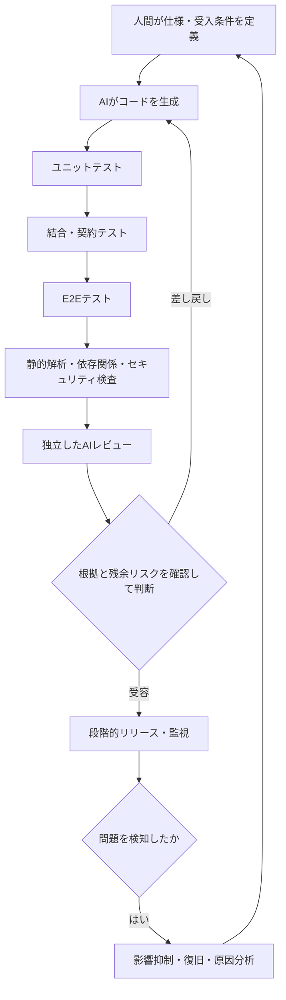

## はじめに

AIが大量のコードを生成できるようになるほど、人間が変更差分を一行ずつ読み、すべてを理解してからリリースする運用は難しくなる。

では、AIが書いたコードをどのように信用すればよいのだろうか。

私は、**コードを生成した主体を信用するのではなく、仕様への適合を検証する仕組みを信用できる状態にする**ことが重要だと考えている。

そのために、ユニットテスト、結合テスト、E2Eテスト、静的解析、セキュリティ検査、AIレビュー、人間の判断を組み合わせる。どれか一つを万能の審査員にするのではなく、異なる種類の失敗を発見できる多層のチェックを設計する。

これは「人間がコードに責任を持たなくてよい」という主張ではない。そもそも、人間がコードを目視確認しても、誤りをすべて発見できるわけではない。**人間がレビューしたことと、正しさが保証されたことは同義ではない。**

むしろ、人間が責任を果たすための仕事の中心は、実装の逐語的な確認だけに頼ることから、仕様・受入基準・検証基盤の設計、そして問題が起きた後の対応へ移っていくのではないかという仮説である。

## 「動くコード」と「正しいコード」は違う

例えば、ECサイトの割引計算を考える。

仕様が「商品小計から10%割引し、その後に送料を加える」であるとき、商品小計10,000円、送料500円なら請求額は9,500円になる。

ところが、AIが「商品小計と送料の合計から10%割引する」コードを書いたとする。請求額は9,450円となり、コードは例外を出さずに動くかもしれない。しかし仕様には違反している。

しかも、AIが自分の解釈に合わせてテストも作れば、その誤った計算を「正常」と判定する可能性がある。

ここには二つの異なる問いがある。

- **Verification（検証）**：実装が定められた仕様・設計に従っているか
- **Validation（妥当性確認）**：その仕様や成果物が、そもそも利用者のニーズを満たしているか

テストがすべて通っても、期待する振る舞いを仕様に書き漏らしていれば、正しい製品とは限らない。

## 信頼は一回のレビューではなく、多層の証拠からつくる

この図は論理的な検査の層を示したもので、実際のCIでは複数の検査を並列実行してもよい。重要なのは、**それぞれが何を検出でき、何を検出できないか**を明確にすることだ。

### 1. ユニットテスト：小さな振る舞いを検証する

ユニットテストは、関数やクラスなどの小さな単位の振る舞いを高速に確認できる。

割引計算なら、通常値だけでなく、端数、ゼロ円、境界値、不正な入力などを検証する。

ただし、AIがコードとテストの両方を同じ誤解に基づいて生成すれば、両方が誤っていてもテストは成功する。**期待値をどこから導くか**が重要になる。

例えば、仕様書に明記した「小計10,000円、送料500円、10%割引なら9,500円」という受入例を、実装とは独立にテストへ落とし込む。

### 2. 結合・契約テスト：境界での不一致を検出する

個々の関数が正しくても、API、DB、外部サービスとの連携が正しいとは限らない。

リクエスト形式、データ型、エラー時の応答、トランザクションの境界などを確認する。API契約やスキーマの変更は、単体テストだけでは検出できないことがある。

### 3. E2Eテスト：利用者の操作を通して確認する

E2Eテストは、実際の利用者に近い経路でシステム全体の振る舞いを検証する。

例えば「商品をカートに入れ、割引を適用し、注文確認画面に9,500円が表示される」まで確認する。

ただしE2Eテストは一般に実行時間や保守コストが大きく、失敗箇所の切り分けも難しくなりやすい。**すべての検証をE2Eへ寄せるのではなく、各層の役割を分ける**。

Google Testing Blogでも、ユニット・結合・E2Eのテストピラミッドが説明されている。比率は固定の正解ではなく、システム特性に応じて調整する必要がある。

### 4. 静的解析・セキュリティ検査：テスト以外の欠陥を探す

型チェック、Lint、静的解析、依存パッケージの脆弱性検査、秘密情報の混入検出などは、実行時テストとは異なる観点を提供する。

ただし、これらを通過したことは「脆弱性がない」ことの証明ではない。設定ミス、権限の過大付与、業務上の不正な操作など、別途確認が必要な問題もある。

### 5. AIレビュー：仕様・設計とのズレを別の視点で探す

AIレビューは、コード生成とは別の実行・別のコンテキストで行うことに価値がある。

ただし、**別のAIを使えば独立性が保証されるわけではない**。同じ仕様の誤読、同じ欠落した情報、類似のモデル特性によって、生成側とレビュー側が同じ誤りを見逃すことがある。

レビューには、少なくとも次の情報を渡したい。

- 変更目的と受入条件
- 変更前後の差分
- 影響するAPI・データ・権限
- 実行したテストとその結果
- 過去の不具合や設計上の制約（共有可能な範囲）

AIレビューの指摘も**検証対象の仮説**として扱う。指摘が正しいかを確認し、重要な問題は再現テストへ落とし込む。

## 人間が見たからといって、完璧ではない

AIレビューには誤検知や見逃しがある。しかし、それは人間によるコードレビューにも当てはまる。

人間は疲労する。時間の制約もある。差分が大きければ見落としやすくなるし、実装者とレビュアーが同じ仕様を誤解している可能性もある。業務知識が不足していれば、コードとして不自然な箇所がなくても、要求との不一致に気づけない。

つまり、**「人間が目で見た」という事実は、品質保証の一つの証拠にはなっても、正しさの証明にはならない。**

これは人間によるレビューを不要とする主張ではない。人間のレビューには、仕様の妥当性、業務上の影響、リスクの受容など、重要な役割がある。ただし、人間もAIも間違えるという前提に立ち、双方の判断を補完する仕組みを設計する必要がある。

「AIだから信用できない、人間が見たから信用できる」という二分法ではなく、**どの方法で、何を確認し、何をまだ確認できていないか**を問い続けたい。

## 多層化しても「全部同じ誤りを見逃す」ことがある

チェックを5層に増やしても、すべてが同じ誤った仕様を前提にしていれば、同じ欠陥を見逃す。

信頼性を高めるために必要なのは、単なるチェック数ではなく、**失敗の原因を共有しすぎないこと**だ。

例えば次のように、根拠を分ける。

| 検査 | 主な根拠 |
| --- | --- |
| 実装 | 仕様と実装方針 |
| ユニットテスト | 明示的な境界値・期待値 |
| E2Eテスト | 利用者の業務シナリオ |
| AIレビュー | 変更目的・設計制約・差分 |
| 人間の承認 | 事業上のリスクと残余リスク |

特に、**AIに実装させた後で、その実装を見て受入条件を考える**と、テストが実装の追認になりやすい。重要な受入条件は実装前に定義し、必要に応じて独立した担当者が確認する方がよい。

## 人間は何に責任を持つのか

ここでいう責任は、「自分が確認したのだから、絶対にバグは存在しないと保証する」という意味ではない。どれほど慎重にレビューしても、テストを重ねても、欠陥が残る可能性をゼロにはできないからだ。

私が考える責任とは、**その時点で利用できる情報と手段を踏まえ、合理的に必要な検証と対策を尽くしたうえで「これでリリースしてよい」と判断し、それでも問題が起きたときには逃げずに対応すること**だ。

ここで「全力を尽くした」は、無制限に時間やコストをかけることではない。リスクの大きさに見合った手段を選び、必要な確認を省略せず、判断の根拠を説明できる状態を指す。

その責任は、次の四つに整理できる。

### 仕様に対する責任

何を実現するのか。正常系、異常系、権限、性能、データの整合性など、何を満たせば合格なのかを定義する。仕様そのものが誤っていれば、どれだけ実装を忠実に検証しても望む結果にはならない。

### 検証の仕組みに対する責任

ユニットテスト、E2Eテスト、静的解析、AIレビュー、人間のレビューなどをどう組み合わせるか。検査の対象外や見逃しの可能性を把握し、重要な検査を迂回できないようにする。

### リリース判断に対する責任

すべてのリスクを消せない以上、残余リスクを把握して受容できるか判断する。高リスクな変更には追加の確認や承認を要求し、判断の根拠を残す。

### 問題発生後の対応に対する責任

不具合が見つかったら、影響を把握し、必要に応じて停止・切り戻し・修正・利用者への説明を行う。さらに、なぜ検査で見逃したのかを分析し、再発を防ぐために仕様やチェック体制を更新する。

**責任は、リリースの瞬間に終わるものではない。** リリース後の監視、障害対応、再発防止まで含めて初めて成立する。

AIによる実装が増えるほど、エンジニアの責任の重点は、すべてのコードを自分で書くことから、**仕様、検証の仕組み、リリースの意思決定、そして結果への対応**へ移っていくのではないだろうか。

もちろん、これは成果物への責任がなくなるという意味ではない。法令・契約・安全性が関わる領域では、詳細なコード確認や専門家の承認が必要な場合もある。誰が何を承認するかは、組織の責任分担として明確にする必要がある。

## 仕組み自体を、どう信用するか

検証の仕組みを信用するためには、その仕組み自身も継続的に評価しなければならない。

例えば、次のような問いがある。

- テストが実際に欠陥を検出できるか。意図的な変異を加えて確認できるか
- 重要な受入条件がテストに対応づけられているか
- CIの必須チェックを迂回できないか
- AIレビューは過去の既知の不具合を見つけられるか
- 誤検知だけでなく、**見逃し（false negative）**を把握しているか
- リリース後に障害を検知し、戻せるか

レビュー指摘件数が多いことは、それだけでは品質の高さを意味しない。実際に見つけた重大欠陥と、見逃した欠陥を測定する必要がある。

また、テストコードやCI設定もAIが編集できる場合、検査を無効化して「緑色のCI」を作る危険がある。必須チェックや承認ルールは、実装エージェントが自由に変更できない権限設計にする。

## リスクに応じてチェックを変える

すべての変更に同じ重さの検査を課す必要はない。

表示文言の変更と、認証・課金・個人情報処理の変更では、障害時の影響が異なる。変更範囲、データの重要度、外部への影響、ロールバックの容易さなどに応じて、検査と承認の強度を変えるべきだ。

これは「低リスクなら無検証でよい」という意味ではない。**最低限の必須チェックを維持したうえで、高リスク変更には追加の証拠を要求する**という考え方である。

## おわりに：信用する対象を変える

AIが書いたコードを信頼することは、AIの「できました」という報告を信じることではない。同じように、人間の「レビューしました」という報告を、完璧さの証明とみなすことでもない。

**仕様を定め、異なる方法で検証し、残るリスクを理解したうえで「ここまで確認した。これでよい」と判断する。そして、その判断が結果として誤っていたときには、被害を抑え、修正し、仕組みを改善する。**

これが、私の考えるAI時代のコードに対する責任の取り方だ。

AIがコードを書く割合が増えるほど、エンジニアの仕事は「すべてを自分の目で確かめること」だけではなく、**正しさを判断するための証拠を積み重ね、その判断と結果に責任を持つこと**へ重心を移していくのではないだろうか。

## 参考資料

### 一次資料

- [Google Testing Blog — Just Say No to More End-to-End Tests](https://testing.googleblog.com/2015/04/just-say-no-to-more-end-to-end-tests.html)：ユニット・結合・E2Eテストの役割とテストピラミッド。
- [NIST NCCoE — Notional Reference Model for DevSecOps](https://pages.nist.gov/nccoe-devsecops/notational-reference-model.html)：AIを組み込む開発工程におけるガバナンス、検証、追跡可能性、承認の考え方。
- [Android Developers — Testing strategies](https://developer.android.com/training/testing/fundamentals/strategies)：複数のテスト層を使い分ける公式ガイダンス。

本文の「責任の重心が移る」という議論は、これらの資料が断定している将来予測ではなく、筆者の考察である。
