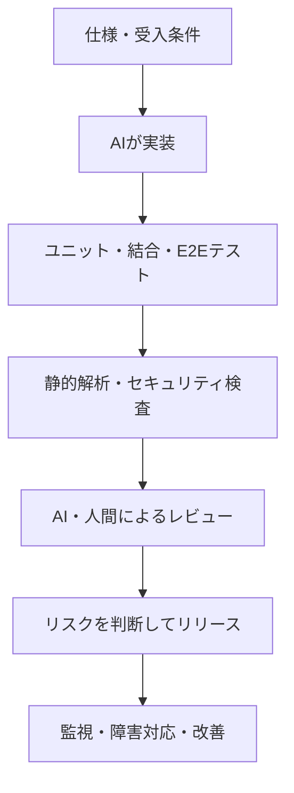

GitHubは[Copilotの責任ある利用に関する文書](https://docs.github.com/en/copilot/responsible-use/agents)で、AIによるコードレビューには**見逃しと誤検知がある**と説明し、人間による確認を推奨しています。

一方、人間によるレビューも欠陥の完全な検出を保証しません。**「誰が見たか」だけでは、コードの正しさは保証できません。**

そこで考えたいのが、**仕様と複数の検証結果を根拠にリリースを判断する**方法です。テストやレビュー自体は新しい技術ではありません。AIが実装を担う時代に、**信頼する対象と人間の責任をどう捉え直すか**がこの記事のテーマです。

## 一つのチェックを信用しすぎない

Googleは[テスト戦略に関する技術記事](https://testing.googleblog.com/2015/04/just-say-no-to-more-end-to-end-tests.html)で、ユニットテスト、結合テスト、E2Eテストの役割を説明しています。E2Eだけに頼ると、実行が遅く、失敗原因も特定しにくくなります。

AIが生成したコードでも、異なる観点のチェックを組み合わせることが重要です。

それぞれの役割は異なります。

- **ユニットテスト**：個々の処理が期待どおり動くか
- **結合・E2Eテスト**：機能やユーザー操作が成立するか
- **静的解析・セキュリティ検査**：実行テストとは別の欠陥がないか
- **AI・人間によるレビュー**：仕様、設計、変更意図とのズレがないか

ここで大切なのは、**チェックの数ではなく、根拠の違い**です。

## テストが通っても間違う例

例えば「商品価格から10%割引し、最後に送料500円を加える」という仕様を考えます。

商品価格10,000円なら、正しい請求額は9,500円です。

ところがAIが「送料を加えてから10%割引」と誤解すると、9,450円を返すコードを書くかもしれません。さらに同じ解釈でテストを作れば、**間違ったコードなのにテストは成功します**。

だからこそ、実装とは独立した受入条件が必要です。仕様に「この入力なら9,500円」と明記し、その値を検証する。AIレビューにも同じ実装の説明だけでなく、元の仕様を渡します。

もちろん、仕様そのものが間違っていれば、これでも防げません。最終的には、利用者が求める振る舞いを定義できているかも確認する必要があります。

## 人間の責任はどこにあるか

人間のレビューも完璧ではありません。では、AIが書いたコードの責任をどう考えるべきでしょうか。

AI生成コードを受け入れる際の責任を、次の3つに整理できます。

1. **仕様を決める**：何を満たせば正しいのかを明確にする。
2. **検証の仕組みを整える**：どのチェックを通すか、何を見逃し得るかを把握する。
3. **判断と結果に向き合う**：残るリスクを理解してリリースし、問題が起きたら対応する。

品質保証の検査は、**無欠陥を証明するものではありません**。

リリース前には、リスクに応じた検証と承認を行い、判断根拠を記録します。リリース後に問題が見つかれば、影響を抑え、修正し、再発防止につなげます。これは、すべての欠陥を事前に発見できないことを前提とした運用です。

人間のレビューを廃止する話ではありません。変更の危険度に応じて、専門家による確認や追加テストが必要です。

## まとめ

AIのコードを無条件に信じる必要はありません。同時に、人間の目を絶対視する必要もありません。

**仕様を定め、異なる観点から検証し、根拠を持って判断する。問題が起きたら対応し、検証の仕組みを改善する。**

AIによる実装を運用に組み込むには、コードレビューだけでなく、**仕様・検証・承認・障害対応を一体で設計すること**が必要です。

## 参考資料

- [GitHub Docs — GitHub Copilot Agents: Limitations](https://docs.github.com/en/copilot/responsible-use/agents)
- [Google Testing Blog — Just Say No to More End-to-End Tests](https://testing.googleblog.com/2015/04/just-say-no-to-more-end-to-end-tests.html)
- [Anthropic — 2026 Agentic Coding Trends Report](https://resources.anthropic.com/2026-agentic-coding-trends-report)
