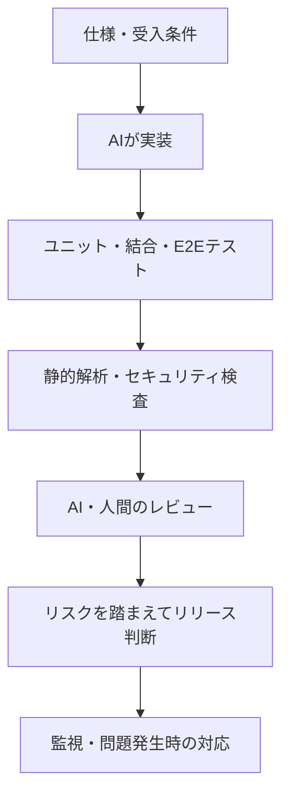

AIがコードを書く時代、私たちは何を根拠に「このコードは問題ない」と判断すればよいのでしょうか。

私は、**コードを書いた主体ではなく、コードを検証する仕組みを信頼する**ことが重要だと考えています。

## 人間が見ても完璧ではない

AIは間違えます。しかし、人間も間違えます。

人間がコードをレビューしても、見落としは起こります。

つまり、**人間が確認したことは、正しさの保証にはなりません。**

必要なのは、誰か一人の判断に頼らない仕組みです。

## 多層のチェックで信頼を積み重ねる

例えば、次のようなチェックを組み合わせます。

- **ユニットテスト**：個々の処理が正しいか
- **結合・E2Eテスト**：機能全体が期待どおり動くか
- **静的解析・セキュリティ検査**：別の観点から問題を探す
- **AI・人間によるレビュー**：仕様や設計とのズレを確認する

もちろん、チェックを増やせば完璧になるわけではありません。

重要なのは、それぞれ異なる観点から確認することです。AIが実装とテストを同じ誤解に基づいて作れば、テストが通っても仕様違反が残ることがあります。

## エンジニアの責任はどう変わるか

AIが実装を担うほど、人間の役割は変わっていくと思います。

コードを書くことだけでなく、**何を作るべきか、どう検証するか、どこまで確認すればリリースできるか**を決める役割です。

そして、責任とは無欠陥を保証することではありません。

その時点で必要な対策を尽くし、「これでよい」と判断すること。

それでも問題が起きたら、対応し、改善することです。

## まとめ

AIのコードを無条件に信用する必要はありません。同時に、人間の目を絶対視する必要もありません。

**仕様を定め、検証の仕組みを整え、判断と結果に責任を持つ。**

これが、AI時代のエンジニアに求められる姿勢だと考えています。

## 参考資料

- [Google Testing Blog — テストピラミッド](https://testing.googleblog.com/2015/04/just-say-no-to-more-end-to-end-tests.html)
- [Android Developers — Testing strategies](https://developer.android.com/training/testing/fundamentals/strategies)
